# 6D pose estimation from depth images with twinchers: ITODD benchmark

This directory documents how we are building a benchmark for [twincher](https://github.com/arkady-gonoskov/twincher) ([A. Gonoskov, arXiv:2605.13470](https://arxiv.org/abs/2605.13470)) on a widely used dataset: estimating the 6D pose of industrial objects from depth images of the [MVTec ITODD](https://www.mvtec.com/company/research/datasets/mvtec-itodd) dataset, in the setting of the [BOP benchmark](https://bop.felk.cvut.cz/). The work proceeds in small stages, each removing a simplification of the previous one. Part I of this file describes **milestone 1**: one object model (a cylinder), poses of single instances in real depth images, with object masks given. Part II describes **milestone 2**: twinchers with four parameters for an object without symmetries, the basis of its pose estimation. Part III presents the **metrics and results** for both objects on all their instances in ITODD, with and without the amodal mask. Part IV adds the **analyses for the preprint**: Gauss–Newton in observation space for comparison, convergence on real data and the noise tolerance of the cylinder twinchers with the tent kernel; the training cost against the number of parameters is analysed in Section 16.

**Summary of milestone 1.** For the cylinder of ITODD (object 12), two twinchers trained only on renderings of the CAD model find the pose of the object in real depth images by Gauss–Newton iteration in their learned representation space, starting from a fixed initial guess. On the 4 validation instances with ground truth, the pose error (MSSD, the measure of BOP) is 0.65–1.24 mm, i.e. 0.6–1.2 % of the object diameter, far below the strictest correctness threshold of BOP (5 %). On 70 test instances (ground truth not public), 67 solutions match the observed silhouette and depth (silhouette IoU ≥ 0.95, depth difference ~1 mm), including instances that are cut by the image border or for which up to ~90 % of the object surface has no depth (occlusions, shadows of the structured-light sensor). The remaining depth difference to the sensor has no systematic offset and its scatter equals that of the ground-truth poses.

**Summary of milestone 2.** For a tee connector (object 26), an object without symmetries, the pose seen by the stencil camera has four parameters (distance, elevation, azimuth, roll), covered by six charts. Six twinchers trained only on renderings of the CAD model are now embeddings of their charts: on the required range, $`\det(\partial r/\partial p) > 0`$ at all test points, and Gauss–Newton iteration from a fixed start solves 100 % of random synthetic views to within 0.01 of the parameter ranges (98–99 % to within 0.001). Getting there required understanding two kinds of defects of the learned maps ("wrinkles" and "vortices"), a new stencil based on Fourier–Bessel components of the depth map, constraining the twincher outside the trained range, more capacity, and protection of long trainings against rare "explosions". A short study at the end shows that resetting Adam's momentum at the first sign of negative determinants prevented both explosions that we replayed. Part II describes what we tried, what worked and what we learned about training twinchers.

## Contents

Part I. Milestone 1: the cylinder

1. [Task, data and simplifications](#1-task-data-and-simplifications)
2. [Overview of the approach](#2-overview-of-the-approach)
3. [The forward model (stencil)](#3-the-forward-model-stencil)
4. [Training the twinchers](#4-training-the-twinchers)
5. [Unknown pixels: the fused-target solver](#5-unknown-pixels-the-fused-target-solver)
6. [Real images: LidarFit](#6-real-images-lidarfit)
7. [Limitations and next steps](#7-limitations-and-next-steps)
8. [Reproducing the results](#8-reproducing-the-results)
9. [Files](#9-files)

Part II. Milestone 2: 4D twinchers for an object without symmetries

10. [The object, its charts and the training task](#10-the-object-its-charts-and-the-training-task)
11. [Two kinds of defects](#11-two-kinds-of-defects)
12. [A stencil that sees the shape: Fourier–Bessel components](#12-a-stencil-that-sees-the-shape-fourierbessel-components)
13. [Making the training robust](#13-making-the-training-robust)
14. [The recipe and the six charts](#14-the-recipe-and-the-six-charts)
15. [What did not help](#15-what-did-not-help)
16. [Training cost and the number of parameters](#16-training-cost-and-the-number-of-parameters)
17. [What we learned about twinchers](#17-what-we-learned-about-twinchers)
18. [Suppressing loss spikes in the late stages of training](#18-suppressing-loss-spikes-in-the-late-stages-of-training)
19. [Next steps](#19-next-steps)
20. [Reproducing milestone 2](#20-reproducing-milestone-2)
21. [Files of milestone 2](#21-files-of-milestone-2)

Part III. Metrics and results

22. [Positioning](#22-positioning)
23. [Pipeline and configurations](#23-pipeline-and-configurations)
24. [Instances and the availability of data](#24-instances-and-the-availability-of-data)
25. [Metrics](#25-metrics)
26. [Results](#26-results)
27. [Whole scenes](#27-whole-scenes)
28. [Further indicative metrics](#28-further-indicative-metrics)
29. [Reproducing Part III](#29-reproducing-part-iii)
30. [Files of Part III](#30-files-of-part-iii)

Part IV. Analyses for the preprint

31. [Analyses for the preprint](#31-analyses-for-the-preprint)

# Part I. Milestone 1: the cylinder

## 1. Task, data and simplifications

### The BOP task

[BOP](https://bop.felk.cvut.cz/) evaluates 6D pose estimation of known rigid objects. In the task *6D localization of seen objects*, a method receives a test image together with the list of objects visible in it and the number of their instances, and has to return the rotation $`R`$ and translation $`t`$ (model to camera) of each instance. Methods may be trained on the 3D models of the objects and on synthetic images rendered from them, but not on test images. A pose counts as correct if its error is below a threshold; the errors are VSD (visible surface discrepancy), MSSD (maximum symmetry-aware surface distance) and MSPD (maximum symmetry-aware projection distance), with thresholds from 5 % to 50 % of the object diameter (MSSD), and the score is the average recall over these thresholds. The ground truth of the test images is not public; results are evaluated by submission to the BOP server.

### ITODD and the depth sensor

ITODD (Drost et al., ICCV workshops 2017) shows 28 industrial objects in realistic arrangements (single objects, bin-picking-like piles), observed among others by a high-quality structured-light 3D sensor (multi-shot spacetime stereo). The BOP version contains its depth maps (1280 × 960 pixels, Z in mm) and grayscale images. There are no real training images: methods have to be trained from the CAD models. We use **depth only**, which avoids the dependence on illumination of intensity images.

We first looked at the quality of the depth maps ([`depth_to_png.py`](depth_to_png.py) converts them into viewable images; the shaded relief makes noise and artifacts visible):

| Shaded relief (validation image 3) | Depth as colour (validation image 702), black: no depth |
|---|---|
| 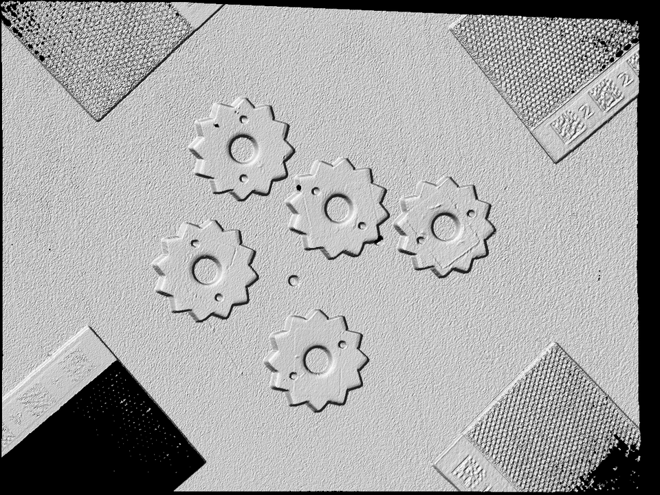 | 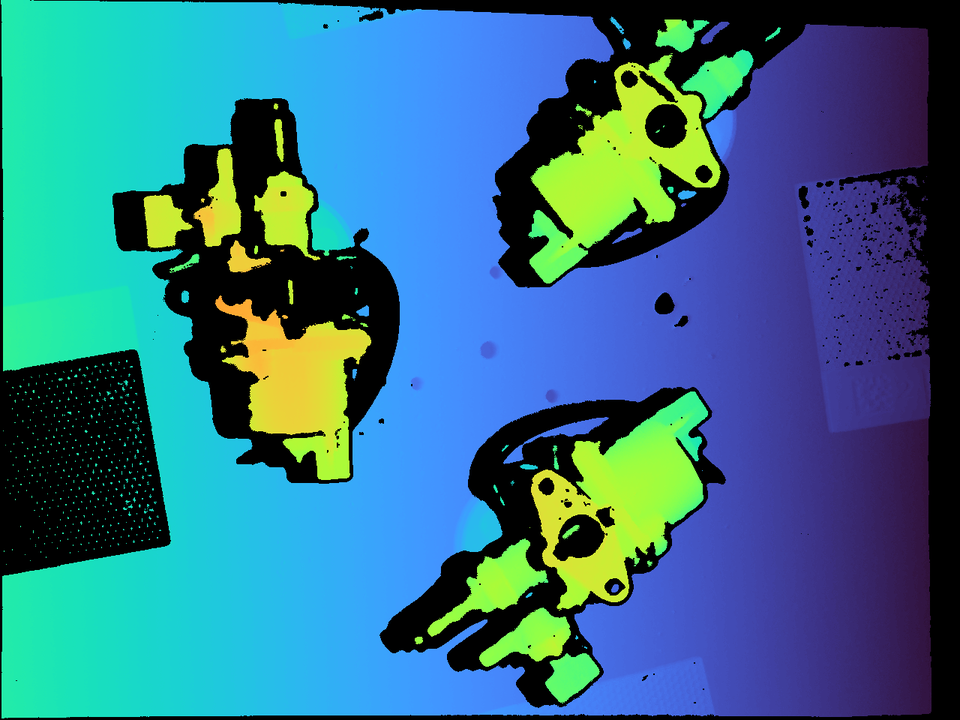 |

- The noise on flat table areas is 70–90 µm RMS and nearly uncorrelated between pixels: the depth data are very precise.
- 10–24 % of the pixels have no depth: wide-baseline stereo leaves a "shadow" beside every object (always on the same side), and glossy surfaces return no measurement. In the synthetic (PBR) training images of BOP, by contrast, every pixel has a depth.

### The object

We start with object 12, a cylinder of radius 20 mm and height 100 mm (BOP diameter 107.7 mm). It is symmetric under rotations about its axis and under a flip of the axis, so its pose has 5 relevant degrees of freedom (3 for the position, 2 for the direction of the axis). Once the image is centred on the object, 3 remain to be found from its appearance (distance, elevation, roll; see below); the other 2 follow from the position of the object in the image. In the validation set it appears in 2 images (4 instances, all lying on a table), in the test set in 13 images (70 instances, partly stacked and occluded).

### Simplifications at this milestone

- **One object model**, the cylinder.
- **Object masks given**: we use the masks of BOP (`mask`: the full silhouette including occluded parts; `mask_visib`: its visible part) to locate the instance and to know which pixels belong to it. These masks are derived from the ground truth; at test time they would have to come from a segmentation. This is the main simplification to be removed later.
- **Evaluation**: pose errors against the ground truth on the validation images; on the test images (ground truth not public), agreement of the solution with the observed depth and silhouette.

## 2. Overview of the approach

A twincher learns a representation $`r(y)`$ of observations $`y`$ in which the composite map $`p \mapsto r(y(p))`$ from parameters to representation is a well-conditioned bijection; the inverse problem $`y(p) = y_\text{observed}`$ is then solved by Gauss–Newton iteration in $`r`$-space, which uses the exact forward model and therefore converges to the precision permitted by the data (see the [paper](https://arxiv.org/abs/2605.13470) and the [package README](https://github.com/arkady-gonoskov/twincher)). Here:

- **Forward model ("stencil")**: parameters $`p`$ (distance and view direction of the camera) → depth map rendered from the CAD model → vector $`y`$ of 256 probe values. Section 3.
- **Training** (offline, per object and chart of view directions): twinchers learn $`r(y)`$ from $`y`$ and $`\partial y/\partial p`$ on a grid of $`p`$, first for a bijective representation, then for robustness to perturbations of $`y`$. Section 4.
- **Inference**: Gauss–Newton iteration in $`r`$-space, generalized to observations with unknown pixels (Section 5), applied to real depth images after resampling them into the frame of the stencil (Section 6).

The work is organized to go through the following stages:

| Stage | Content | Section |
|---|---|---|
| 1 | Stencil: parametrization, rendering, probes, derivatives | 3 |
| 2 | Training of a twincher, solver on synthetic data | 4.1 |
| 3 | Training for robustness to perturbations | 4.2 |
| 4 | Solver for observations with unknown pixels | 5 |
| 5 | Real images: LidarFit, second chart, image borders | 6 |

## 3. The forward model (stencil)

Code: [`depth_stencil.py`](depth_stencil.py) (class `DepthStencil`); checks in [`check_stencil.py`](check_stencil.py); images in [`render_stencil_views.py`](render_stencil_views.py).

### 3.1 Parameters and charts

The camera looks at the origin of the model (the centre of the cylinder) from the distance $`D`$, from a direction given by the elevation $`e`$ above the plane perpendicular to the cylinder axis, and is rotated by the roll $`\psi`$ about its optical axis ($`\psi = 0`$: the cylinder axis points up in the image). The azimuth about the cylinder axis does not matter (symmetry); for objects without symmetry it is a fourth parameter (supported by the stencil). Each parameter is mapped linearly from $`p_k \in [-1, 1]`$:

| Parameter | Meaning | Range |
|---|---|---|
| $`p_0`$ | distance $`D`$ | 638.38–775.97 mm (the camera–object distances of the ITODD test images given by BOP) |
| $`p_1`$ | elevation $`e`$ | $`\pm(\pi/2 - 0.3)`$, i.e. ±72.8° |
| $`p_2`$ | roll $`\psi`$ | chart A: ±72.8°; chart B: 17.2°…162.8° |

$`p = 0`$ is the typical view in ITODD: a cylinder lying on the table, seen from above. The ranges stay away from views where the inverse problem is ill-posed: a view along the cylinder axis (roll undefined) and, because of the flip symmetry, the borders of the roll range, where $`(e, \psi)`$ and $`(-e, \psi + \pi)`$ show the same image. One such parameter domain is a *chart*; two overlapping charts (A and B) cover all roll angles, and a separate twincher is trained for each.

### 3.2 Rendering

For each $`p`$, the depth map is rendered by ray casting on the CAD mesh with [NVIDIA Warp](https://github.com/NVIDIA/warp) on the GPU: 512 × 512 rays over a fixed square of the image plane that contains the object at the smallest distance (±5.3°, about 557 pixels of the ITODD camera; 1.09 camera pixels per stencil pixel). The value of a pixel is the depth $`Z`$ along the optical axis (as in the BOP depth maps), 0 where the ray misses the object. Rendering a depth map takes about 0.1 ms per view in batches.

### 3.3 Probes

The depth map is condensed into $`n_y = 16 \times 16 = 256`$ values $`y_j`$ by probes on a regular grid:

- **Pyramid kernels.** Each probe looks at a square window of half-size $`K`$ = probe spacing (32 pixels) around its centre $`c_j`$ and reports
  ```math
  Z_j = Z_\text{bg} + \min_{\|d\|_\infty < K} \left[\big(Z(c_j + d) - Z_\text{bg}\big)\left(1 - \frac{\|d\|_\infty}{K}\right)\right],
  ```
  where $`Z_\text{bg}`$ is the largest possible depth, assigned to the background. A point probe would jump when the object edge crosses it; the weight that vanishes at the border of the window makes the probe value continuous as the image moves, and pixels without depth are simply ignored (they do not contribute), which makes the probes tolerant of missing pixels.
- **Encoding.** $`y_j = 0.8\,\big(2 (Z_j - Z_\text{lo}) / (Z_\text{bg} - Z_\text{lo}) - 1\big)`$, so that all possible depths of the object (584.5–829.8 mm) map to $`[-0.8, 0.8]`$ and the background to 0.8, inside the window in which the twinches act.
- **Centring.** The grid is centred at the centre of mass of the object's silhouette in the image (with sub-pixel precision), because for real images the position of the object origin is unknown, whereas its silhouette can be found. $`y`$ is therefore invariant to shifts of the object in the image; the position is recovered separately (Section 6.2).
- **Order.** The components are ordered from the centre of the grid outward. An untrained twincher is the identity, so its representation $`r`$ consists of the first $`n_p`$ components of $`y`$; these must see the object for the training to start.

| Depth map (probes: orange on the object, blue on background; +: centre of mass) and probe values | One distance, all elevations (rows) and rolls (columns) of chart A |
|---|---|
| 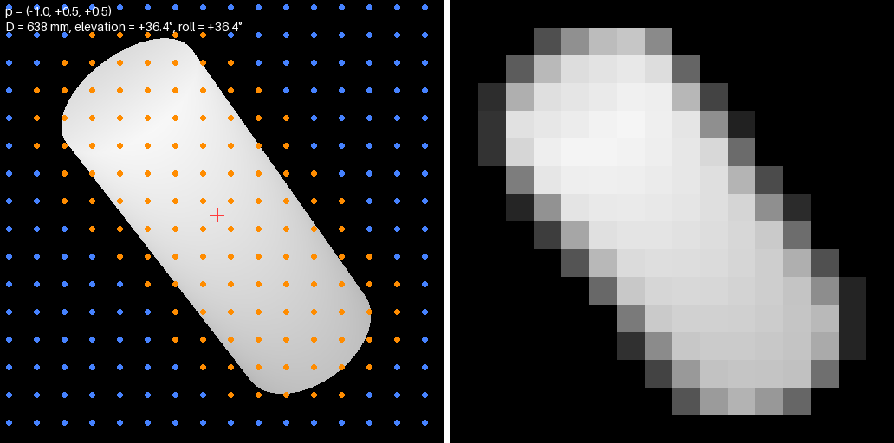 | 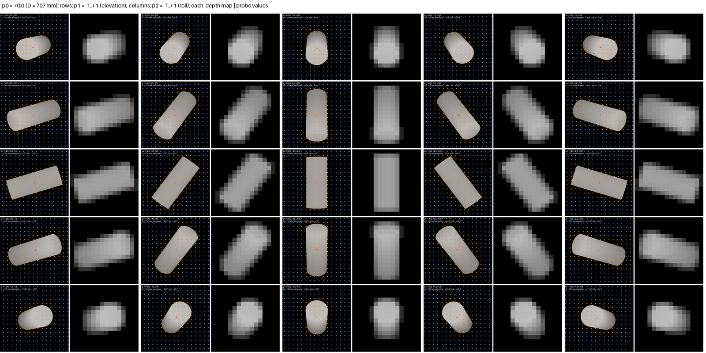 |

### 3.4 Derivatives

The training and the solver need $`\partial y/\partial p`$. Because the depth map is sampled on pixels, $`y(p)`$ changes in small steps when the silhouette moves by a pixel, and very small finite-difference steps measure only this quantization (and miss the motion of the edge). [`study_fd_step.py`](study_fd_step.py) and [`plot_fd_step.py`](plot_fd_step.py) compare central differences for steps $`\Delta p`$ from $`10^{-4}`$ to 0.3 and resolutions from 256² to 2048²:

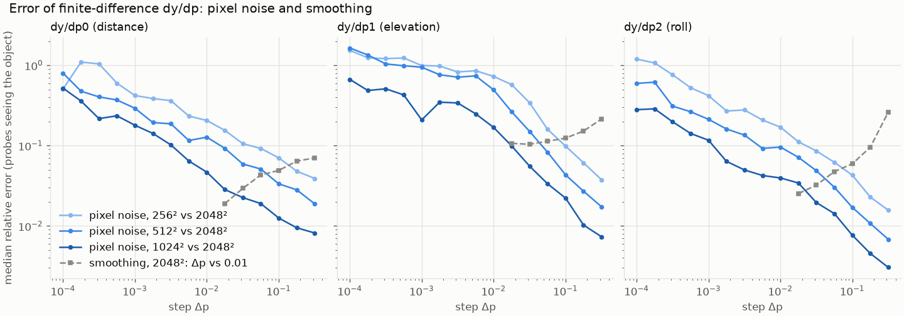

The error from pixel quantization falls as $`1/(\text{resolution} \times \Delta p)`$, while steps above ~0.05 smooth over the curvature of $`y(p)`$. We use $`\Delta p = 0.05`$ at 512², with median errors of a few per cent; one evaluation of $`y`$ and $`\partial y/\partial p`$ (7 renderings) takes about 1 ms per view in batches.

## 4. Training the twinchers

### 4.1 A bijective representation

Code: [`train_cylinder.py`](train_cylinder.py), solver test [`test_cylinder.py`](test_cylinder.py).

The training follows the *hyper-sail* procedure of the package (architecture `hs`): a twincher with $`n_s = 256`$ (one component per probe) and $`n_l = 256`$ layers learns $`r`$ such that $`\det(\partial r/\partial p)`$ stays above a margin, starting from a small cube $`[-R, R]^3`$ of parameters and growing it as long as the determinant stays positive everywhere. $`y`$ and $`\partial y/\partial p`$ are computed once on a $`32^3`$ grid of $`p`$ and interpolated multilinearly during training (31 s). With the default settings of the package at the time (twincher 0.1.0; `HS_0_1_0` in [`train_cylinder.py`](train_cylinder.py)), $`R`$ reached 1 after about 3000 iterations, and the determinant then stayed well away from zero (training stopped after 5500 iterations, 12 minutes on a laptop GPU):

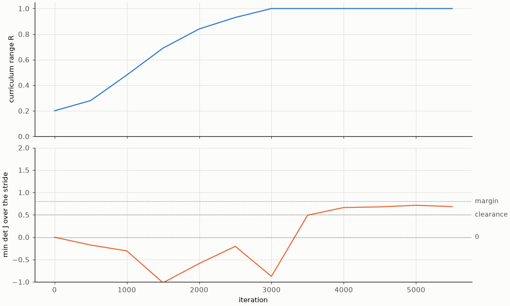

Solving the inverse problem for 1024 random views from the fixed start $`p = 0`$ converges in all cases within 5–10 Gauss–Newton steps; the remaining error (median $`1.2 \times 10^{-3}`$ in $`p`$, i.e. 0.05 mm and 0.04°) is set by the pixel quantization of the forward model: with the same twincher it drops threefold when the stencil is rendered at 1024².

### 4.2 Robustness to perturbations

Code: [`train_noise.py`](train_noise.py), test [`noise_check_depth.py`](noise_check_depth.py).

Real observations deviate from the rendered data manifold (sensor noise, model mismatch, missing pixels). The training is therefore continued with an additional loss term of the package, `hs_sm_noise`: for each training case it determines the single direction perpendicular to the data manifold along which $`r`$ changes most, and penalizes that change (an adversarial, single-mode version of the noise term of the paper), also at random points near the manifold (`y_range` = 0.05). The determinant term keeps the representation bijective meanwhile:

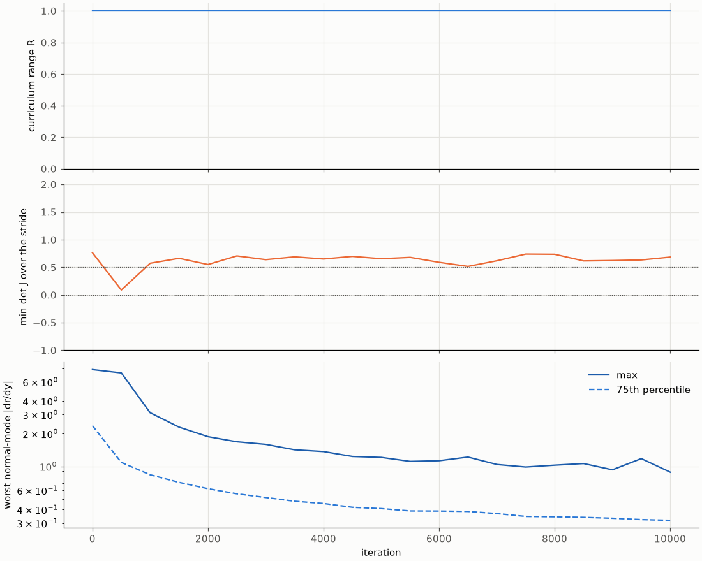

The test adds noise perpendicular to the manifold to the observations of 1024 views and solves for $`p`$ (same procedure as `twincher.noise_check`):

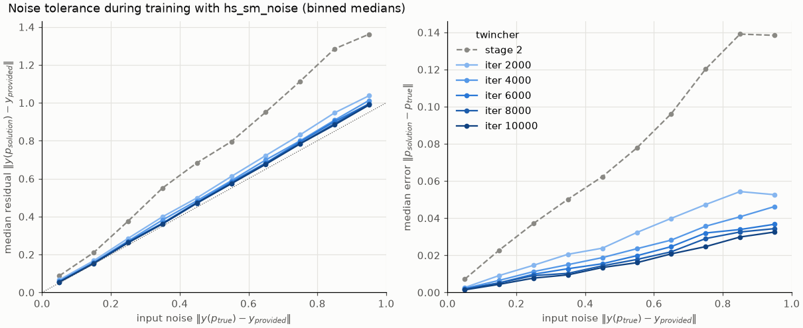

The error of $`p`$ grows linearly with the noise; its slope dropped from 0.149 (without noise training) to 0.031 after $`10^4`$ iterations, most of it within the first 2000. The residual approaches the noise norm (ratio 1.03), i.e. the solution approaches the least-squares projection of the noisy observation onto the data manifold, which is the best possible outcome to first order (Proposition 2 of the paper). The training also improved the accuracy on noise-free views threefold (median $`3.7 \times 10^{-4}`$), because the pixel quantization of the forward model acts like a perturbation.

### 4.3 A second chart

The twincher of chart B (roll 17°–163°) was trained with the same procedure (stopped after 5000 and $`10^4`$ iterations) and reaches the same accuracy on synthetic views. Together, charts A and B cover all view directions with elevations within ±72.8°.

## 5. Unknown pixels: the fused-target solver

Code: [`fused_solver.py`](fused_solver.py), test [`test_unknown.py`](test_unknown.py).

In real depth images many pixels of the object are unknown: occluded by other objects, without depth (sensor shadows, glossy surfaces), or outside the image. Treating them as background makes the observation inconsistent with every pose. The solver therefore *chases* a target that depends on the current estimate: at each step, the unknown pixels of the observed depth map are filled with the depth map rendered at the current $`p`$ (the *fused* map), and the step goes from $`r_\text{curr} = r(y(p))`$ towards $`r_\text{fused} = r(y_\text{fused}(p))`$. At a fixed point the rendering agrees with all available pixels; with no unknown pixels this is the plain solver. The residual $`F(p) = r_\text{fused}(p) - r_\text{curr}(p)`$ is a function of $`p`$ alone, so the damping of the package's solver applies unchanged. Since $`r_\text{fused}`$ itself changes with $`p`$ through the filled pixels, the step uses the Jacobian of the whole residual (Newton's method for $`F(p) = 0`$),
```math
\Delta p = \left(J_\text{curr} - J_\text{fused}\right)^{-1} F(p), \qquad J = \frac{\partial r}{\partial y} \frac{\partial y}{\partial p},
```
where $`\partial y_\text{fused}/\partial p`$ comes from the same renderings as $`\partial y/\partial p`$. Far from the solution this Jacobian can be nearly singular; the solver is therefore run twice, with this step and with the simpler step $`J_\text{curr}^{-1} F`$, and the better result is kept.

The synthetic test hides 2–3 elongated elliptical regions (1:5) of the object in rendered views (examples below, from the first version of the test) and counts the views solved within $`|\Delta p| < 0.05`$ after 10 steps:

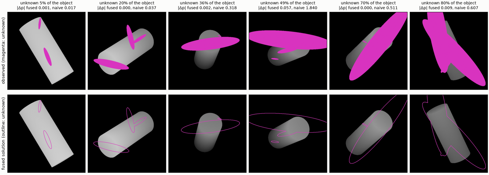

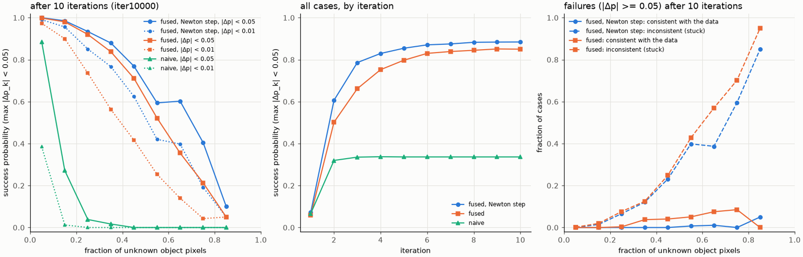

With a fixed target (unknown pixels as background, "naive") the success drops to 27 % already at 10–20 % unknown pixels; the fused solver solves 93 % of the views with 20–30 % and 60 % of those with 60–70 % unknown pixels. The training for robustness (Section 4.2) matters here: without it the success is markedly lower, and again most of the gain is reached within the first 2000 iterations:

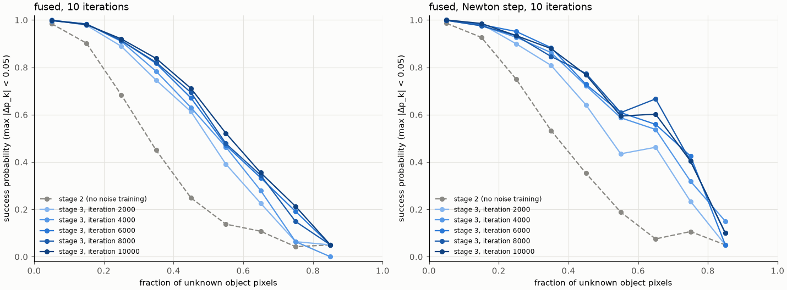

## 6. Real images: LidarFit

Code: [`lidar_fit.py`](lidar_fit.py) (class `LidarFit`), configuration of this milestone [`lidarfit_obj12_m1.json`](lidarfit_obj12_m1.json), runs [`run_lidarfit.py`](run_lidarfit.py).

### 6.1 The pipeline

`LidarFit.process_instance(path, image, instance)` takes a BOP scene directory and processes one object instance:

1. Read the depth map, the masks and the camera intrinsics.
2. **Virtual camera.** The object is generally off-centre in the camera image (up to ~10°), whereas the stencil looks at the object. The real camera is therefore turned (by the smallest rotation) so that its axis points at the object, and the depth map is resampled into the square of the stencil seen by this virtual camera, converting the depth to depth along its axis (a plain crop would leave depth errors of ~10 mm). Pixels outside the mask are background; pixels of the mask without depth, occluded (`mask` but not `mask_visib`) or outside the image are unknown.
3. **Solve** with the fused-target solver for each chart (A, B) and each step variant, from $`p = 0`$, 20 steps each, and keep the solution that best matches the observation (smallest difference between rendering and observation on the known pixels).
4. **Pose.** The stencil camera looks at the model origin from the distance $`D`$ with known orientation; combined with the rotation of the virtual camera this gives $`R`$ and $`t`$ in the real camera frame.
5. **Evaluation**: pose errors against the ground truth if available (translation, angle of the symmetry axis, MSSD with the symmetries of the model); the depth map of the solution rendered with the real camera (saved as TIFF, like the BOP depth maps) and its difference to the sensor depth on the available pixels; silhouette IoU with the mask.

The configuration file records all settings and the reasons for them (`"decisions"`). One instance takes about 3 s (2 charts × 2 step variants × 20 steps, rendering and evaluation included).

### 6.2 Where is the object? The stencil centre

Since the probes are centred at the centre of mass of the silhouette, $`y`$ carries no information about the position of the object in the image; the position enters only through the alignment between the observed map and the rendering. We describe it by the *stencil centre* $`c`$, the direction of the model origin: the observation is resampled for a stencil camera aimed at $`c`$, so that a correct $`c`$ puts the observed object exactly where the rendering puts it, and the pose follows directly from $`c`$. Three ways to determine $`c`$ are implemented (`"centre"` in the configuration):

- `com`: the camera points at the centre of mass of the mask, and the pose is completed by matching the centres of mass of rendering and observation. Simple, but the observation and the rendering are slightly misaligned during the solution, and a mask cut by the image border shifts the centre of mass.
- `com_track` (default): before each step, $`c`$ is moved so that the centre of mass of the observed silhouette (in the fused map, i.e. completed by the rendering where unknown) coincides with that of the rendering; the shift is divided by the observed fraction of the silhouette, as if the rendering were right.
- `dist_y`: before each step, $`c`$ is moved towards the minimum of a quadratic model of $`\|y_\text{fused}(c) - y_\text{curr}\|^2`$, fitted on a 3 × 3 grid of centres (step 10 % of the square, trust region of twice the step, step accepted only if the distance decreases). It does not rely on centres of mass and may become useful with masks from a segmentation.

Image borders: with `"edge_cases": true` (default), instances cut by the border are processed, the pixels outside the image being unknown. To test this with ground truth, [`test_edges.py`](test_edges.py) cuts the validation instances by a virtual border from each side, so that 10 %, 25 % or 40 % of the extent of the mask lies outside (48 cases). With chart A only, the fraction of cases with MSSD below 5 % of the diameter is 29 % for `com`, 60 % for `dist_y` and 83 % for `com_track`:

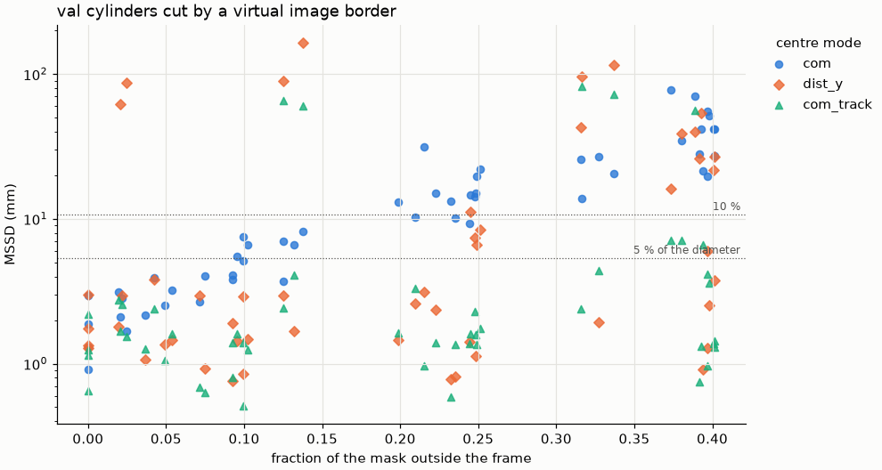

With both charts, `com_track` solves 94 % of the cut cases (median MSSD 1.4 mm), and all those cut by up to 25 %:

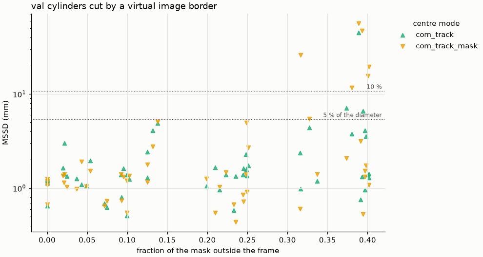

Moving the centre does not harm the instances inside the image: with `com_track`, the pose errors on the uncut validation instances are smaller than with `com` (MSSD median 1.17 mm instead of 1.59 mm).

### 6.3 Results on ITODD

Validation instances (ground truth available), default configuration:

| Instance | Translation error | Axis angle error | MSSD | MSSD / diameter |
|---|---|---|---|---|
| image 230, instance 0 | 0.46 mm | 0.13° | 0.65 mm | 0.6 % |
| image 233, instance 0 | 0.67 mm | 0.38° | 1.14 mm | 1.1 % |
| image 233, instance 1 | 0.41 mm | 0.82° | 1.24 mm | 1.2 % |
| image 233, instance 2 | 0.74 mm | 0.47° | 1.20 mm | 1.1 % |

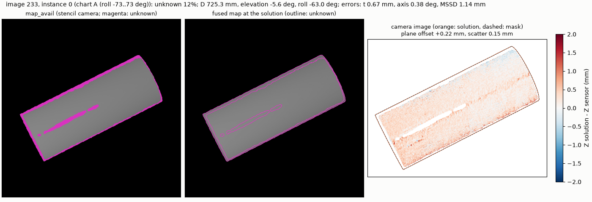

*Left: the observation resampled into the stencil (magenta: unknown pixels: a sensor shadow along the upper edge and a glossy streak); middle: the fused map at the solution; right: $`Z_\text{solution} - Z_\text{sensor}`$ in the camera image, with the silhouettes of the solution (orange) and of the BOP mask (dashed).*

Test instances (70 cylinders in 13 images; no ground truth): a solution is counted as good if its silhouette matches the BOP mask with IoU ≥ 0.95, which in practice goes together with a depth difference of about 1 mm.

| Configuration | Inside the image | Cut by the border | Validation MSSD (median, max) |
|---|---|---|---|
| chart A, `com` | 42 of 58 | (dismissed) | 1.59 mm, 2.96 mm |
| charts A + B, `com` | 55 of 58 | (dismissed) | 1.59 mm, 2.96 mm |
| charts A + B, `com_track`, border cases included (default) | 57 of 58 | 10 of 12 | 1.17 mm, 1.24 mm |

The views missing with chart A alone are cylinders lying nearly horizontally in the image (roll near 90°), outside chart A. The median fraction of unknown object pixels in the test instances is 41 %; of the 25 instances with more than 50 % unknown, 22 are solved. The three failures have 94–96 % of the object unknown. Two solved examples, an instance in the image corner partly occluded by another cylinder and an instance of which more than half lies outside the image:

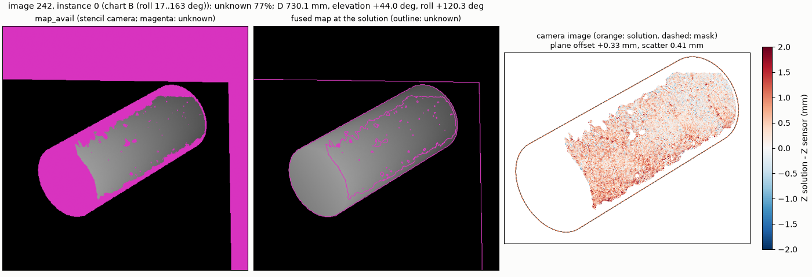

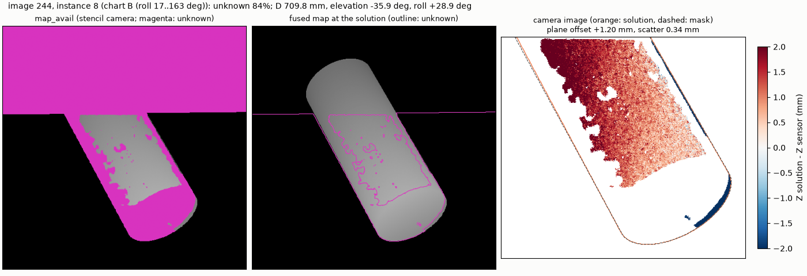

### 6.4 How well do the solutions fit the sensor data?

[`analyze_depth_diff.py`](analyze_depth_diff.py) examines the signed difference $`\Delta Z = Z_\text{solution} - Z_\text{sensor}`$ on the interior pixels of the object (edge pixels excluded), fitting a plane per instance with outliers removed:

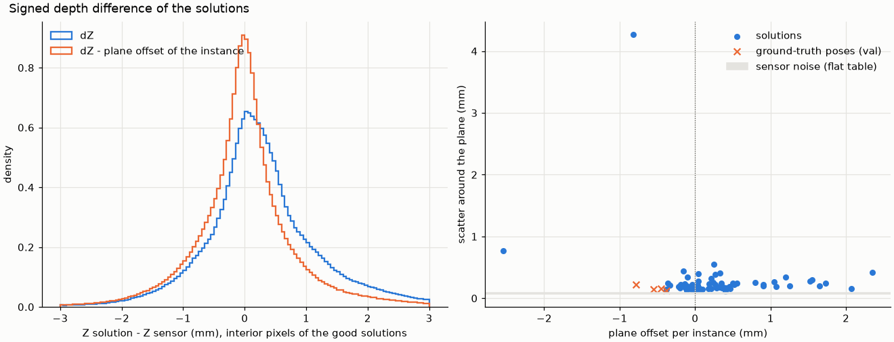

- **No systematic offset**: the plane offset of the validation solutions is −0.20…+0.22 mm, closer to the sensor data than the ground-truth poses (−0.38…−0.79 mm).
- **The scatter is not caused by the solver**: around the plane it is ~0.2 mm, the same as for the ground-truth poses on the same pixels; it exceeds the sensor noise on a flat table (0.08 mm), presumably because of deviations between the real objects and the CAD model and systematic errors of the sensor, which no pose can remove.
- **Lateral offset on test images**: on many test instances, $`\Delta Z`$ varies across the cylinder (see below): the depth data prefer a pose shifted sideways by 0.6 mm (median) from the solution, which follows the silhouette of the BOP mask. Shifting the solution accordingly ([`lateral_check.py`](lateral_check.py)) removes most of this variation; on the validation images the preferred shift is only 0.15 mm. In some stacked test scenes the BOP masks and the depth data thus disagree by 2–3 pixels; a lateral refinement using the depth would remove this dependence on the masks.

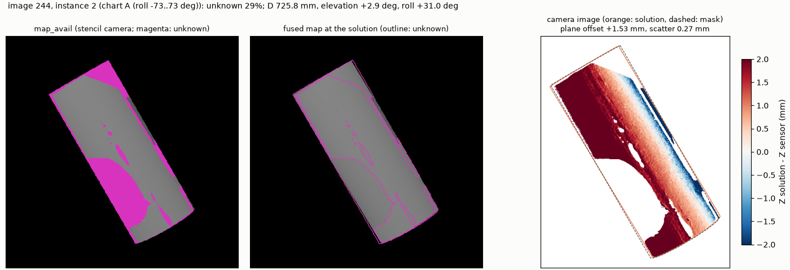

## 7. Limitations and next steps

- **Masks.** The method uses the masks of BOP, which are derived from the ground truth and not available at test time. Next: work with a visible-part mask from a segmentation, deciding from the depth data where the object is occluded and where it ends (the `dist_y` centring is meant for this).
- **More objects.** Onboarding of other ITODD models: choice of charts for objects with fewer symmetries (four parameters), training of several twinchers per object, and a dictionary of twinchers for scenes with several objects.
- **Lateral position.** Refinement of the position with the depth data rather than the silhouette alone.
- **Extreme occlusion.** Instances with more than ~90 % unknown pixels are not solved reliably; multiple starting points could help.
- **Benchmark.** Output in the BOP format and evaluation with the BOP toolkit on the validation set; eventually a submission.

## 8. Reproducing the results

Requirements: Python ≥ 3.10, [twincher](https://github.com/arkady-gonoskov/twincher) (main branch, which contains the loss term `hs_sm_noise` and the options of the hs loss used here) with GPU support, PyTorch with CUDA, `warp-lang` 1.17, NumPy, Pillow and Matplotlib. The ITODD data of BOP (base archive, models, validation and test images) are expected in one directory (`itodd_base/`, `itodd_models/`, `itodd_val/`, `itodd_test_all/`), given by the environment variable `ITODD_DIR` (default: `ITODD/` in this directory; [`itodd_data.py`](itodd_data.py)). Outputs are written to `output_*` directories next to the scripts.

The hs loss of the package gained options during this work (Sections 13 and 18), and its defaults changed. Each training script therefore states the loss settings of its runs where they differ from the current defaults (`HS_0_1_0` in [`train_cylinder.py`](train_cylinder.py): the hs loss of twincher 0.1.0, with which the twinchers of Part I and the first runs of Part II were trained), so that the runs are repeated exactly.

Run from this directory, in this order (times on a laptop with an NVIDIA GeForce RTX 5050):

```bash
export ITODD_DIR=/path/to/ITODD                # the ITODD data of BOP
python depth_to_png.py "$ITODD_DIR"/itodd_val/val/000001/depth output_depth_png/val_000001_shade --mode shade
python check_stencil.py                    # geometry, conventions, speed of the stencil
python render_stencil_views.py             # 125 views and overviews
python study_fd_step.py && python plot_fd_step.py
python -u train_cylinder.py                # chart A, representation (12 min)
python test_cylinder.py                    # solver on synthetic views
python -u train_noise.py                   # chart A, robustness (40 min)
python noise_check_depth.py
python test_unknown.py                     # unknown pixels (5 min)
python -u train_cylinder.py output_train_cylinder_roll90 --roll-range 0.3 2.8415926535897933
python -u train_noise.py output_train_noise_roll90 --init output_train_cylinder_roll90/final.twc \
    --data output_train_cylinder_roll90/data_n32_res512_dp0.05_centre_roll0.300_2.842.pt
python run_lidarfit.py --config lidarfit_obj12_m1.json --out-dir output_lidarfit_m1   # real images (4 min)
python test_edges.py --config lidarfit_obj12_m1.json --modes com,dist_y,com_track
                     # virtual borders on val (lidarfit_obj12_chartA.json, chart A only, gives figures/edges_chart_A.png)
python analyze_depth_diff.py output_lidarfit_m1 --config lidarfit_obj12_m1.json
python lateral_check.py output_lidarfit_m1 --config lidarfit_obj12_m1.json
python summarize_lidarfit.py m1=output_lidarfit_m1
```

## 9. Files

| File | Purpose |
|---|---|
| [`depth_to_png.py`](depth_to_png.py) | Depth maps of BOP as viewable images (gray, colour, shaded relief) |
| [`itodd_data.py`](itodd_data.py) | Location of the ITODD data (environment variable `ITODD_DIR`) |
| [`depth_stencil.py`](depth_stencil.py) | The forward model: parametrization, rendering (Warp), kernel probes, derivatives; conversion of BOP poses into stencil parameters |
| [`check_stencil.py`](check_stencil.py) | Checks of geometry, conventions and speed of the stencil |
| [`render_stencil_views.py`](render_stencil_views.py) | Images of stencil views with their probes |
| [`study_fd_step.py`](study_fd_step.py), [`plot_fd_step.py`](plot_fd_step.py) | Choice of the finite-difference step |
| [`train_cylinder.py`](train_cylinder.py) | Training of a twincher (representation) on grid data of the stencil |
| [`test_cylinder.py`](test_cylinder.py) | Solver test on synthetic views |
| [`train_noise.py`](train_noise.py) | Continued training for robustness (`hs_sm_noise`) |
| [`noise_check_depth.py`](noise_check_depth.py) | Noise tolerance of saved twinchers |
| [`fused_solver.py`](fused_solver.py) | Solver for observations with unknown pixels (fused target, Newton step) |
| [`test_unknown.py`](test_unknown.py) | Test of the solvers with synthetic unknown regions |
| [`lidar_fit.py`](lidar_fit.py) | `LidarFit`: pose of an instance in a BOP depth image |
| [`lidarfit_obj12_m1.json`](lidarfit_obj12_m1.json), [`lidarfit_obj12_chartA.json`](lidarfit_obj12_chartA.json) | Configuration of LidarFit for the cylinder at this milestone, with the reasons for the settings; the same with chart A only |
| [`run_lidarfit.py`](run_lidarfit.py) | LidarFit on all cylinder instances of ITODD |
| [`test_edges.py`](test_edges.py) | Image borders with ground truth (virtual borders on validation images) |
| [`summarize_lidarfit.py`](summarize_lidarfit.py) | Comparison of runs |
| [`analyze_depth_diff.py`](analyze_depth_diff.py) | Signed depth difference of the solutions |
| [`lateral_check.py`](lateral_check.py) | Lateral offset between solution and depth data |
| [`figures/`](figures/) | Figures of this file |

# Part II. Milestone 2: 4D twinchers for an object without symmetries

The cylinder of Part I needed only three parameters per chart: its symmetries made the azimuth irrelevant. A general industrial part has none, and its appearance depends on four parameters: the distance, two angles of the view direction and the roll. This part describes how we trained twinchers with four parameters ("4D twinchers") for such an object. It covers what failed and why, how we diagnosed the failures, and which changes made the training reliable. The result is the input of the next milestone: six trained twinchers that together cover all views of the object.

## 10. The object, its charts and the training task

### 10.1 The connector

Object 26 of ITODD is a tee connector: a main pipe with a branch, both ending in bores. It has no exact symmetry, though it is nearly symmetric under a half-turn about one axis. We describe a view by four parameters, each mapped linearly from $`p_k \in [-1, 1]`$:

| Parameter | Meaning | Range |
|---|---|---|
| $`p_0`$ | distance $`D`$ | 638.38–775.97 mm (as in Part I) |
| $`p_1`$ | elevation $`e`$ of the camera above a plane of the model | $`\pm\pi/3`$ (±60°) |
| $`p_2`$ | azimuth $`\varphi`$ within that plane | $`\pm 5\pi/6`$ (±150°) |
| $`p_3`$ | roll $`\psi`$ about the optical axis | $`c \pm 5\pi/12`$ (±75° about a centre $`c`$) |

As in Part I, the camera of the stencil looks at the origin of the model, and the position of the object in the image gives the remaining two degrees of freedom (Section 6.2).

### 10.2 Six charts

No single box of parameters covers all views without singularities, so we use six *charts*, each with its own twincher (definitions in [`train_chart.py`](train_chart.py) and `CHART_AXES` in [`depth_stencil.py`](depth_stencil.py)):

- two families of view directions. **ChartZ** measures the elevation from the plane perpendicular to the model's Z axis, which points up in the image at roll 0. **ChartY** does the same with the Y axis;
- three roll centres per family: $`c = 0, \pm 2\pi/3`$. The roll range of a chart (150°) is wide enough to overlap its neighbours but too narrow to contain two rolls 180° apart. Such rolls look alike because of the near half-turn symmetry.

The charts are named Z0, Z1, Z2, Y0, Y1, Y2. Every pose of the object lies in at least one chart with $`|p|_\infty \le 0.857`$. Each twincher therefore has to be reliable only on the box $`|p|_\infty \le 0.86`$, not on the whole domain. This box is the target of the training.

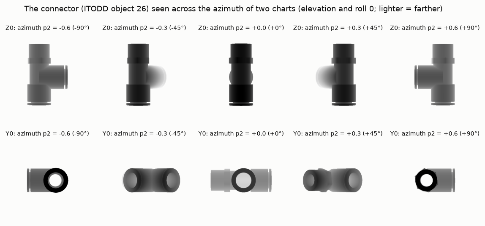

*Depth maps rendered by the stencil (figure from [`figures_m2.py`](figures_m2.py)). The centre of ChartZ0 looks at the side of the main pipe. The centre of ChartY0 looks straight into the bore of the branch, and at $`\varphi = \pm 90°`$ along the main pipe. These "bore views" turned out to be the core difficulty of this milestone.*

### 10.3 The training task in brief

For each chart, a twincher learns a representation $`r(y)`$ such that $`p \mapsto r(y(p))`$ is one-to-one with a well-conditioned Jacobian $`J = \partial r / \partial p`$ on the box. The inverse problem is then solved by Gauss–Newton iteration in $`r`$-space (Section 2). The training uses the *hyper-sail* procedure of the package (Section 4.1), whose parts appear throughout this part:

- **Determinant loss**: $`a\,(\det J - 0.8)^2`$ for every training case with $`\det J < 0.8`$. It pushes $`r(y(p))`$ towards an orientation-preserving, non-degenerate map.
- **Trimmer**: $`a_t \sum_k \max\big(0, |\partial r/\partial p_k| - 1.3\big)^2`$. It keeps $`r`$ from stretching: a map with $`\det J > 0.8`$ could otherwise grow without bound.
- **Curriculum**: training cases are drawn from a box $`[-R, R]^4`$. $`R`$ grows by a small step after 10 consecutive batches in which every case has $`\det J > 0.5`$ (a *promotion*). $`R`$ is the natural measure of progress, and $`R = 0.86`$ is the goal.
- **Data**: $`y`$ and $`\partial y / \partial p`$ are precomputed on a grid of $`p`$ and interpolated multilinearly. Rendering during training would be too slow: each case needs 9 renderings.
- **Optimizer**: Adam (package defaults $`\beta_1 = 0.99`$, $`\beta_2 = 0.999`$) with a damper that halves the learning rate when consecutive gradients point in opposite directions.

A twincher is evaluated with exact (rendered) data, never with the interpolated training data. We compute $`\det J`$ at 8192 random points of the box, and solve 512–1024 random synthetic views by Gauss–Newton from $`p = 0`$ with 40 steps. A view counts as solved if $`\max_k |\Delta p_k| < 0.01`$, i.e. 0.7 mm in distance, 0.6° in elevation, 1.5° in azimuth and 0.75° in roll.

### 10.4 Starting point

We first applied the setting of Part I to the four-dimensional charts: 16 × 16 probes, a $`16^4`$ grid and 256–512 layers. The Z charts trained to $`R \approx 0.9`$, and once the solver clamped $`p`$ to the trained box, they solved 98–100 % of the views. The three Y charts stalled at $`R`$ = 0.83–0.89, and the solver failed on 60–71 % of their views. The solver did not stall in those cases. It converged to a *different* $`p`$ with the same $`r`$: the map was not one-to-one, although $`\det J > 0`$ almost everywhere. Most of this milestone went into understanding and removing this failure on ChartY0, the hardest chart.

## 11. Two kinds of defects

To study ChartY0 quickly, we started by considering a *reduced* variant. Only the elevation and azimuth vary, the distance and roll are fixed at the centre of their ranges ([`train_chart.py`](train_chart.py), `ReducedStencil`), and the ranges can optionally be scaled down. With $`n_p = 2`$ the whole map $`p \mapsto r`$ can be drawn, and a run takes minutes. [`wrinkle_map.py`](wrinkle_map.py) draws it, together with the exact and interpolated $`\det J`$, the interpolation error, the solver errors and the winding numbers introduced below.

The setting also became smaller than in Part I: $`n_s = 128`$ twincher components, 8 × 8 probes with *flat* kernels (the mean height in each cell of the stencil square; $`n_y = 64`$), a finite-difference step of 0.025 ([`study_fd_step_chart.py`](study_fd_step_chart.py)) and batches of $`n_c = 5120`$ cases. Runs: [`y0_reduced.py`](y0_reduced.py).

We found two kinds of defects, which we refer to as *wrinkles* and *vortices*.

### 11.1 Wrinkles: the training data must resolve y(p)

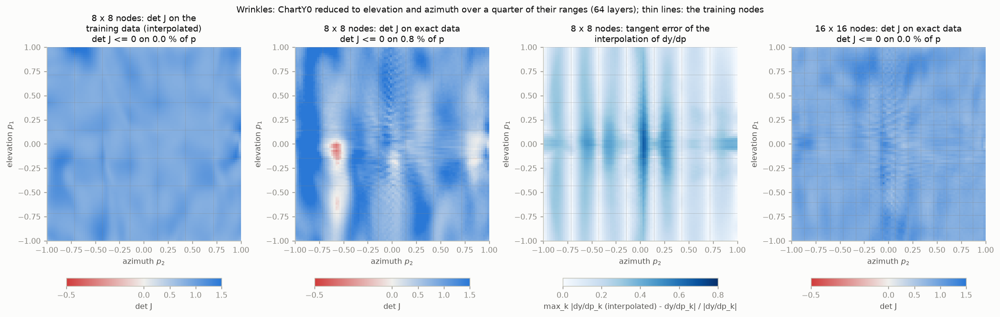

The twincher only sees the training data. Between grid nodes, the multilinearly interpolated tangent vectors $`\partial y / \partial p`$ can differ from the true ones by up to 80 %. With 8 nodes per component (over a quarter of the ranges), the twincher satisfies its training data perfectly: $`\det J > 0`$ everywhere on the interpolated data (first panel). With exact data, however, $`\det J \le 0`$ on 0.8 % of the views (second panel), in patches where the tangent error is large (third panel). The solver fails on 10 % of the views there. With 12 or 16 nodes, the same training gives a clean map (fourth panel) and solves 99.8–100 % of the views.

This gives a practical criterion: **the 90 % quantile of the tangent error of the interpolation should be below about 0.2**. [`grid_tangent.py`](grid_tangent.py) evaluates candidate grids without any training. For the full ranges of ChartY0, it asks for about 32 nodes in elevation, 96 in azimuth and 24 in roll. The distance needs only 8, being limited by the finite-difference noise of $`\partial y / \partial D`$. In four dimensions this means 589,824 grid nodes, 46 minutes of rendering and 755 MB of data. Section 13.4 removes this cost.

### 11.2 Vortices: det J > 0 almost everywhere, yet not one-to-one

With adequate grids, the full-range 2D ChartY0 still failed. With the default curriculum, it stalled at $`R = 0.2`$, the start of the curriculum. With a finer curriculum (Section 13.2), it grew but folded at $`R \approx 0.53`$ and stalled at $`R = 0.735`$ after 40,000 iterations. The solver failed for most views with $`e > 0`$.

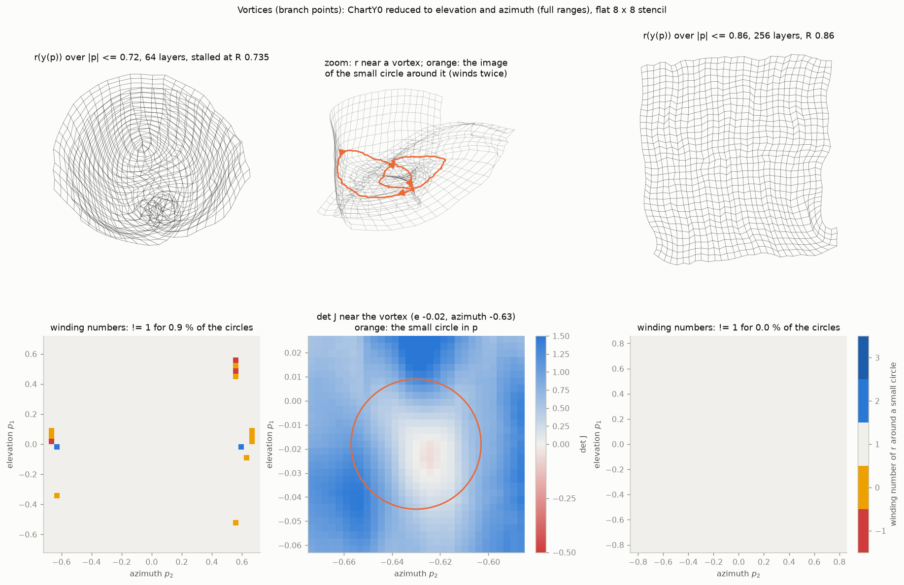

The top row shows $`r(y(p))`$ as the image of a grid of lines in $`p`$. The twincher with 64 layers (left) folds the sheet over itself. The right one, with 256 layers, is a regular sheet. To find such defects in any dimension, we compute **winding numbers** ([`winding.py`](winding.py)). For an embedding, the image of every small circle in $`p`$ winds exactly once around its centre in $`r`$-space. At the defects of the left twincher, the image of a small circle winds *twice* (orange curve in the zoom). Such a point is a branch point, like $`z \mapsto z^2`$ at the origin, and we call it a *vortex*. Around a vortex the map is two-to-one. $`\det J`$ is non-negative around it and falls below 0.5 only in a tiny disc (bottom middle). The determinant loss therefore hardly sees the defect, while the promotion rule sees just enough to block the curriculum. Winding numbers 0 and −1 mark folds.

The vortices sit exactly at the bore views: $`e \approx 0`$ with $`\varphi \approx \pm 0.6`$ (along the main pipe) and the centre of the chart (into the branch). The forward model itself is not singular there: the smallest singular value of $`\partial y / \partial p`$ is ≥ 1.15, and distant views do not collide in $`y`$. However, as the view direction changes slightly, the inner surfaces visible through a bore appear and disappear (*visibility events*). $`y(p)`$ then nearly turns back on itself: along short paths in $`\varphi`$, the chord between the end points of the curve $`y(p)`$ is only 0.26 of its arc length.

**More capacity removed the vortices in 2D.** With 256 layers instead of 64, the run recovered from the fold at $`R \approx 0.53`$ and reached $`R = 0.86`$ after 12,000 iterations, with winding number 1 at all 3600 test circles. It solved 99.2 % of the views to < 0.01, and none failed by more than 0.1. For comparison, ChartZ0 in the same setting trains cleanly with 64 layers in 8000 iterations.

**In 3D it was not enough.** With elevation, azimuth and roll (grid 32 × 96 × 24, [`y0_expand.py`](y0_expand.py)), all runs with the flat stencil folded catastrophically at $`R`$ = 0.515–0.532. This held for 256 and 512 layers, for learning rates 1e-3 and 0.5e-3, and for starts from the clean 2D twincher. The runs then kept lines of vortices along the whole roll range ([`slice_dets.py`](slice_dets.py)). The lines lie at $`e = 0`$, $`\varphi = \pm 0.25`$, where a far surface seen through the branch bore disappears. The data themselves had to become easier.

Winding numbers are part of every exact check in [`chart_training.py`](chart_training.py). It logs the fraction of small circles (tiling the plane of the first two components, at three slices of the others) with winding number ≠ 1, and the winding number of a large circle around the centre of the chart.

## 12. A stencil that sees the shape: Fourier–Bessel components

To make our stencil more uniformly descriptive, we replaced the probes by the lowest components of a Fourier–Bessel expansion of the depth map ([`depth_stencil.py`](depth_stencil.py), option `fb`; runs in [`y0_fb.py`](y0_fb.py)). Heights $`h(\rho, \theta)`$ are sampled on a disc about the centre of mass of the silhouette, whose radius is half the stencil square (128 × 512 polar points). They are expanded in the orthonormal Bessel modes of the disc:

```math
f_{nm} = \int_{\rho \le 1} h(\rho, \theta)\, N_{nm} J_m(j_{mn} \rho)\, e^{-i m \theta}\, \rho\, d\rho\, d\theta ,
```

where $`j_{mn}`$ is the $`n`$-th zero of the Bessel function $`J_m`$ and $`N_{nm}`$ normalizes the mode. The 64 components of $`y`$ are the real and imaginary parts of the modes in "shells" $`|m| + 2(n - 1) = 0, 1, 2, \dots`$ (up to $`|m| = 9`$, $`n = 6`$). Each part $`c_k`$ is damped and squashed:

```math
y_k = \text{ISRU}\big(C\, e^{-(n / 3)^2}\, c_k\big), \qquad \text{ISRU}(x) = \frac{x}{\sqrt{1 + x^2}} ,
```

so that fine radial structure is suppressed and all values stay in $`(-1, 1)`$, where the twinches act ($`C = 12`$). Two further choices proved important:

- **A near background.** Heights are measured from a plane 20 mm behind the mean depth of the visible object, and clipped at zero. In milestone 1 they were measured from the farthest possible depth $`Z_\text{bg}`$. Deep parts, such as the inside of a bore or a surface seen through it, then drop out of $`y`$, and these are the parts that cause the visibility events.
- **A depth component.** With the near background, the heights no longer depend on the distance except through the scale. One extra component, $`\text{ISRU}\big(6\,(Z_\text{mean} - Z_\text{mid}) / (Z_\text{bg} - Z_\text{lo})\big)`$, where $`Z_\text{mid}`$ is the middle of the depth range of Section 3.3, restores the information on the distance.

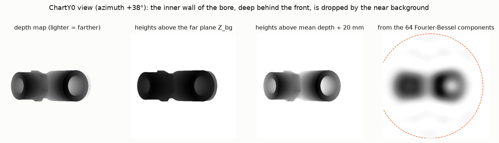

*Heights above the far plane are nearly uniform, so the shape is a small modulation on a large offset. Above the near background, the inner wall of the right bore vanishes. The 64 components keep the coarse shape (right).*

Before any training, [`stencil_metrics.py`](stencil_metrics.py) measures properties of $`y(p)`$ that matter for the twincher. It uses the (elevation, azimuth) plane of ChartY0, $`|p| \le 0.86`$:

| Stencil | chord/arc, minimum | $`\sigma_\text{min}/\sigma_\text{max}`$ of $`\partial y/\partial p`$, 1 % quantile | tangent error of a 32 × 96 grid, 90 % / 99 % |
|---|---|---|---|
| flat 8 × 8 probes | 0.26 | 0.05 | 0.10 / 0.20 |
| Fourier–Bessel, heights above $`Z_\text{bg}`$ | 0.25 | 0.04 | 0.07 / 0.21 |
| Fourier–Bessel, near background (20 mm) | **0.45** | **0.07** | **0.05 / 0.14** |

*Chord/arc: for short paths in $`\varphi`$ (0.063), the distance between the end points of $`y`$ divided by the length of the curve $`y(p)`$. It is 1 for a straight curve and small where the curve turns back. Conditioning: elevation, azimuth and roll.*

The near background raises the smallest chord/arc ratio from 0.26 to 0.45, i.e. $`y(p)`$ turns back much less, and it halves the 90 % quantile of the tangent error of the interpolation. In training, the Fourier–Bessel stencil passed the points where the flat stencil had failed. In 2D with 64 layers, it reached $`R = 0.60`$ after 9000 iterations almost without negative determinants (the flat stencil was at 0.50, with recurring folds and vortices). In 3D with 256 layers, it passed $`R = 0.52`$ without a fold (all flat-stencil runs had folded at 0.515–0.532) and stayed clean up to 0.657. Then both runs **collapsed** suddenly, at $`R = 0.70`$ and $`0.667`$: within one stride, the loss rose from $`10^{-3}`$ to about 2 and $`\det J`$ became negative on hundreds of thousands of cases.

## 13. Making the training robust

### 13.1 Collapses: what happens outside the box matters

Nothing in the loss constrains $`r`$ outside the current box $`[-R, R]^n`$. In a twincher saved shortly before a collapse ($`R = 0.572`$), $`\max_k |\partial r/\partial p_k|`$ was ≤ 1.7 inside the box. Just beyond it ($`|p|_\infty`$ = 0.572–0.62) the 99 % quantile was 45 and the maximum 71, with $`\det J \le 0`$ on 30 % of the cases. Further out it reached 198. When the box grows into such a region, each new case contributes a trimmer loss of about $`(50 - 1.3)^2 \approx 2400`$, while the total loss is around $`10^{-3}`$. One such batch dominates the gradient and wrecks the map.

The remedy is to **apply the trimmer over the whole domain**. An extra pass per iteration evaluates the trimmer alone on $`n_c`$ cases drawn uniformly from $`[-1, 1]^n`$ (now the option `trimmer_domain_amp` of the package's hs loss, on by default). This keeps $`r`$ tame where the curriculum will go. With it, the most negative determinant beyond $`R`$ was −1.5…−2.9, instead of −35…−600. The 2D run with 64 layers reached $`R = 0.86`$ cleanly (the flat stencil had needed 256 layers). The 3D run with 256 layers became **the first functional 3D ChartY0**: at $`R = 0.86`$, $`\det J > 0`$ at all test points, all views solved and all winding numbers 1.

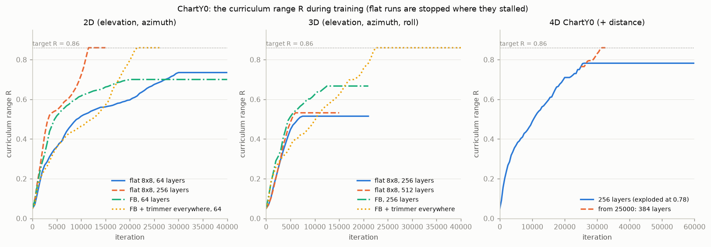

### 13.2 A fine curriculum

The default curriculum of the package starts at $`R = 0.2`$ and grows in steps of 0.01. The full-range ChartY0 never left $`R = 0.2`$, and its twincher had a vortex at the centre. The first box was already too large for the twincher, which starts as the identity, to form a one-to-one map around the bore view. The quarter-range auxiliary runs, expressed in units of the full ranges, had started at 0.05 with steps of 0.0025. With this **fine curriculum** (`ramp_size` 0.05, `p_range_step` 0.0025) all full-range runs grew, and the centre kept winding number 1 in all Fourier–Bessel runs. From here on we use the hs loss with `ramp_boost` 1.0, i.e. the same amplitude of the determinant loss at the border of the box as inside. The default of twincher 0.1.0, `ramp_boost` 2.0, was meant to double it there, but added at most `ramp_size` times the amplitude per component (its ramp was not divided by `ramp_size`). The package now ramps up to the full factor, and its default is 1.0.

### 13.3 Capacity: adding layers to a trained twincher

In 4D ([`y0_fb.py`](y0_fb.py), run `fbtrim_full`: Fourier–Bessel stencil, grid 8 × 32 × 96 × 24, 256 layers, whole-domain trimmer), ChartY0 reached $`R = 0.765`$ after 25,000 iterations, with 0.8 % solver failures. It then exploded at the step to $`R = 0.782`$ and again, at the same $`R`$, at iteration 49,000, ending in a broken state (third panel above). We added capacity *to the best state* instead of starting over. [`twc_extend.py`](twc_extend.py) inserts a new layer after every second layer (256 → 384 layers). The new layers have zero twist, so they act as identities: the map is unchanged to $`4 \times 10^{-14}`$ in double precision. This works because the `.twc` file stores the wiring of every layer.

Restarting a trained twincher revealed a pitfall, the **restart shock**. A fresh Adam optimizer wrecked the restored map within 50 iterations, even at a learning rate of $`10^{-5}`$. In its first steps Adam moves *every* parameter by about the learning rate (the ratio of its first and second moments is ±1). A trained twincher, by contrast, needs tiny and very uneven steps. The fix ([`chart_training.py`](chart_training.py), `adam_prime` and `warmup`): 1000 iterations that update only Adam's moments (the parameters are restored after each step), then 2000 iterations in which the learning rate rises linearly from 1/100 of its value.

With 384 layers ([`y0_full.py`](y0_full.py), run `l384`), $`R`$ grew from 0.765 to 0.86 in 6500 iterations. The best state (iteration 7500) is **the first functional 4D ChartY0**: no $`\det J \le 0`$, 100 % of 1024 views solved to < 0.01, 98.8 % to < $`10^{-3}`$. Runs with 256 layers and the same restart stalled at $`R \approx 0.78`$, so capacity was the limit there.

### 13.4 A roll-aware interpolator

Rolling the camera rotates the depth map, and a rotation by $`\alpha`$ multiplies each Fourier–Bessel coefficient by a phase: $`f_{nm} \to f_{nm}\, e^{-i m \alpha}`$. The roll therefore needs no grid. [`roll_fb.py`](roll_fb.py) (`RollFB`) stores the complex coefficients and their derivatives on a grid over distance, elevation and azimuth at the roll centre, interpolates them, applies the exact phase of the roll, and computes $`\partial y / \partial \psi`$ analytically. Check against rendered views ([`roll_fb_check.py`](roll_fb_check.py), ChartY0, 1024 random points of $`|p|_\infty \le 0.86`$):

| | full grid (8, 32, 96, 24) | roll-aware grid (8, 32, 96) |
|---|---|---|
| grid nodes | 589,824 | 24,576 |
| time to compute | 46 min | 2 min |
| size | 755 MB | ~30 MB |
| $`\lvert y - y_\text{exact} \rvert`$, median / 90 % / 99 % | 0.014 / 0.026 / 0.031 | 0.003 / 0.005 / 0.009 |
| tangent error, roll | 0.037 / 0.053 / 0.068 | 0.014 / 0.030 / 0.049 |
| tangent error, azimuth | 0.035 / 0.053 / 0.089 | 0.017 / 0.033 / 0.081 |

The roll-aware data are 24 times smaller and more accurate.

### 13.5 Explosions: rollback and a stop criterion

Even with all of the above, rare **explosions** remained: within a few hundred iterations, $`\det J`$ turned negative on a large part of the box. They coincide with spikes of the gradient norm ($`10^3`$–$`3 \times 10^4`$, against ~1) and with large $`|\partial r/\partial p_k|`$ somewhere in the domain (20–90). A small region with a large derivative dominates the batch gradient, and Adam turns it into a coherent step of every parameter. [`chart_training.py`](chart_training.py) writes a trace of the last 1000 iterations whenever an explosion begins:

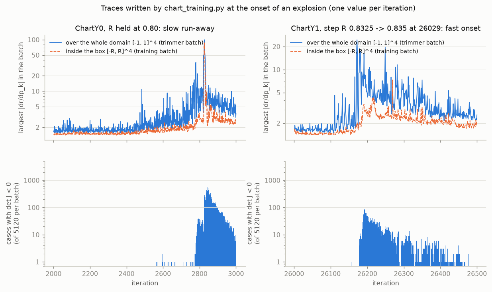

We saw two patterns. In the *slow run-away* (left), at a fixed $`R`$, the largest $`|\partial r/\partial p_k|`$ over the domain drifts up over ~300 iterations, from 1.7 to 3, and then escalates. In the *fast onset* (right), the derivatives jump within ~150 iterations after a step of $`R`$. Three measures in [`chart_training.py`](chart_training.py) make a series of trainings robust to them:

- **Rollback** (`rollback`): after a stride of 500 iterations in which more than 0.1 % of the cases had $`\det J < 0`$, the training returns to the checkpoint of the previous stride, halves the learning rate and reseeds the generator of the training cases (at most 8 times).
- **Best checkpoint**: `best.twc` is the state with the fewest unsolved views at the exact checks (every 2500 iterations).
- **Stop criterion** (`done_exact`): two consecutive exact checks at $`R = 0.86`$ with no $`\det J \le 0`$ and all views solved.

Other attempts to prevent the explosions did not help (Section 15). A reset of Adam's momentum at the first batch with negative determinants did (Section 18).

## 14. The recipe and the six charts

The recipe ([`train_charts_fb.py`](train_charts_fb.py), `RECIPE`) combines Sections 11–13:

| Part | Setting |
|---|---|
| stencil | Fourier–Bessel: 63 components with the near background (20 mm), $`C = 12`$, plus the depth component ($`C_D = 6`$); 512² rendering; finite-difference step 0.025 |
| data | roll-aware grid 8 × 32 × 96 (distance, elevation, azimuth), 2 minutes per chart |
| twincher | $`n_s = 128`$, $`n_l = 384`$ |
| optimizer | Adam, learning rate $`10^{-3}`$, batch of 5120 cases |
| loss | hyper-sail with uniform amplitude (`ramp_boost` 1.0), fine curriculum (start 0.05, steps 0.0025), trimmer also over the whole domain |
| safety | rollback (0.1 % negative determinants, learning rate × 0.5, at most 8 times); `R` held at 0.86; exact checks every 2500 iterations; stop after 2 clean checks |

Z0 was trained first with this recipe, then Z1, Z2, Y1 and Y2 in one resumable series. Y0 comes from the 384-layer continuation of Section 13.3, which used the full 4D grid instead of the roll-aware one.

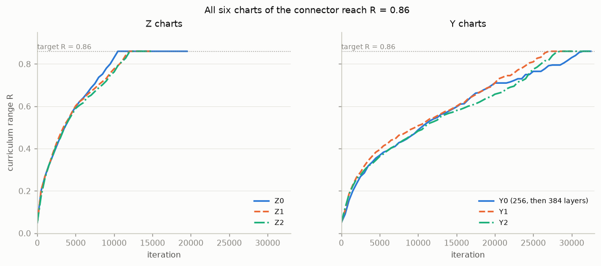

| Chart | $`R = 0.86`$ after | Stopped after | Training time | Rollbacks | $`\det J \le 0`$ | min $`\det J`$ | Views solved < 0.01 | < $`10^{-3}`$ |
|---|---|---|---|---|---|---|---|---|
| Z0 | 10,500 | 19,500 | 144 min | 0 | 0 % | +0.56 | 100 % | 99.0 % |
| Z1 | 12,000 | 15,000 | 56 min | 0 | 0 % | +0.67 | 100 % | 99.2 % |
| Z2 | 12,500 | 15,000 | 56 min | 0 | 0 % | +0.62 | 100 % | 98.8 % |
| Y0 | 31,500 | best at 32,500 | 160 min | (restart, 13.3) | 0 % | +0.26 | 100 % | 98.8 % |
| Y1 | 27,000 | 30,000 | 137 min | 2 | 0 % | +0.45 | 100 % | 97.9 % |
| Y2 | 28,500 | 32,500 | 120 min | 1 | 0 % | +0.53 | 100 % | 98.0 % |

*Iterations; evaluation of `best.twc` with exact data on $`|p|_\infty \le 0.86`$: $`\det J`$ at 8192 random points, Gauss–Newton from $`p = 0`$ (40 steps) on 512 random views (Y0: 1024). Times on a laptop GPU (NVIDIA GeForce RTX 5050), partly shared with other runs. For Y0, 25,000 iterations with 256 layers and 7500 after the extension.*

All six twinchers are embeddings of their charts on all evaluated samples (no $`\det J \le 0`$ at 8192 random points, all views solved; an embedding is verified on samples, not certified). The Y charts take about 2.5 times as many iterations as the Z charts, and their growth slows down after $`R \approx 0.7`$ (figure). They also carry the remaining risk of explosions: Y1 and Y2 exploded at $`R`$ = 0.835 and 0.7575 and recovered by rollback (Y1 needed two).

## 15. What did not help

| Attempt | Purpose | Outcome |
|---|---|---|
| promotion tolerance (`promotion_tol`: a few cases with $`\det J \le 0.5`$ allowed for a promotion; [`stencil_sweep.py`](stencil_sweep.py)) | let $`R`$ grow past isolated low determinants | $`R`$ grew slowly with recurring folds; set aside in favour of fixing the causes |
| exact samples instead of a grid (pool of $`2^{18}`$ rendered views) | rule out the interpolation | same growth of $`R`$ for ChartZ0, same stall at $`R = 0.2`$ for the full-range 2D ChartY0, no overfitting |
| spectral stencil (orthonormal 2D FFT of the cell heights; [`stencil_sweep.py`](stencil_sweep.py)) | smoother components | fine for ChartZ0, ChartY0 stuck at $`R = 0.2`$; set aside |
| separation loss ([`hs_sep_loss.py`](hs_sep_loss.py): nearby pairs of $`p`$ must map to distinct $`r`$) | remove vortices without more layers | no effect (2D, 64 layers: stuck at $`R = 0.567`$) |
| component-wise curriculum (azimuth and elevation over their whole range, the roll growing from 0.05) | build the 3D chart on the clean 2D twincher | stuck at roll range 0.05: the orientation along the new direction has to be fixed at once over the whole plane |
| more layers or a lower learning rate with the flat stencil in 3D | pass $`R \approx 0.52`$ | the same catastrophic fold at 0.515–0.532 |
| gradient clipping at 5 × the running mean of the norm | stop explosions | did not stop the slow run-away (event of 22,868 negative determinants) |
| trimmer amplitude 3 instead of 1 | stop the rise of $`\lvert\partial r/\partial p\rvert`$ | $`R`$ grew much more slowly (0.765 → 0.78 in 4500 iterations) and events still occurred |
| s-gate threshold 2.0 instead of 1.3 | more room in the corners of the 4D box | exploded at $`R = 0.787`$ |
| Adam $`\beta_1 = 0.9`$ instead of 0.99 | less momentum | explosions smaller but still catastrophic (Section 18) |

The ramp with a decreasing amplitude towards the border (`ramp_boost` 0) pushed a vortex out of the box when restarting a twincher with vortices. A control run without the ramp removed it too, but formed a new one later. With one run each, this is suggestive but not conclusive ([`y0_vortex.py`](y0_vortex.py)).

## 16. Training cost and the number of parameters

*(An analysis of the runs of Sections 13 and 14, made for the preprint; [`figures_paper.py`](figures_paper.py), [`twinch_widths.py`](twinch_widths.py).)*

If a twincher had to represent its domain cell by cell, the training data, the capacity and the number of iterations would all grow with the number of cells that resolve $`y(p)`$, i.e. exponentially with $`n_p`$. The runs of Sections 13 and 14 allow a first check: ChartY0 was trained for $`n_p`$ = 2, 3 and 4 with the same stencil and procedure (up to the differences listed in Section 16.5), and the six charts of Section 14 show the spread between tasks at $`n_p = 4`$.

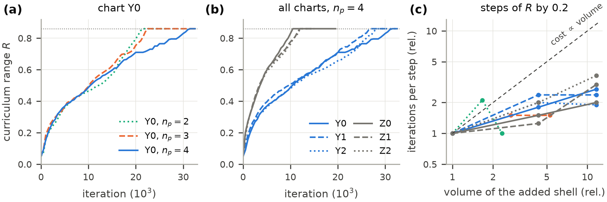

*(a) ChartY0 with $`n_p`$ = 2 (elevation, azimuth; 64 layers), 3 (and roll; 256 layers) and 4 (and distance; 256 layers, 384 from iteration 25,000); dotted: the target $`R = 0.86`$. (b) The six charts at $`n_p = 4`$ (384 layers; Y0 as in (a)). (c) Iterations needed to grow $`R`$ from 0.2 to 0.4, 0.4 to 0.6 and 0.6 to 0.8, against the volume of the shell that each step adds to the box $`[-R, R]^{n_p}`$, both relative to the first step; line styles as in (a) and (b); dashed: a cost proportional to the added volume.*

### 16.1 The runs

All runs use the Fourier–Bessel stencil with the near background (Section 12), $`n_s = 128`$, Adam with the learning rate $`10^{-3}`$, batches of 5120 cases, the fine curriculum (start 0.05, steps 0.0025, Section 13.2), the trimmer over the whole domain (Section 13.1) and $`R`$ held at 0.86. The curriculum grows $`R`$ by one step in every iteration that follows more than 10 consecutive iterations in which all cases of the batch inside the box have $`\det J > 0.5`$. The number of iterations to reach a value of $`R`$ is therefore the number that the twincher needs to satisfy this condition on the growing box. For $`n_p`$ = 2 and 3, ChartY0 is restricted to elevation and azimuth (and roll), with the other parameters at the centre of their ranges (`ReducedStencil` in [`train_chart.py`](train_chart.py)).

| Run | $`n_p`$ | Layers (parameters) | Training data | $`R = 0.86`$ after | Computation (rel.) | Training time |
|---|---|---|---|---|---|---|
| ChartY0 (`output_y0_fb/fbtrim_bg20_l64`) | 2: elevation, azimuth | 64 (16,384) | grid 32 × 96 (3072 nodes) | 21,500 | 1 | 29 min |
| ChartY0 (`output_y0_fb/fbtrim_bg20_d123`) | 3: + roll | 256 (65,536) | grid 32 × 96 × 24 (73,728) | 22,500 | 6.3 | 81 min |
| ChartY0 (`output_y0_fb/fbtrim_full`, then `output_y0_full/l384`) | 4: + distance | 256, then 384 (98,304) | grid 8 × 32 × 96 × 24 (589,824) | 31,500 | 13 | 153 min |
| Z0, Z1, Z2 (`output_charts_fb/`) | 4 | 384 (98,304) | roll-aware grid 8 × 32 × 96 (24,576) | 10,500–12,500 | 5.9–7.0 | 45–88 min |
| Y1, Y2 (`output_charts_fb/`) | 4 | 384 (98,304) | roll-aware grid 8 × 32 × 96 (24,576) | 27,000–28,500 | 15–16 | 106–126 min |

*Iterations. Computation: iterations × layers × $`n_p`$, relative to the 2D run (at a fixed batch, the cost of an iteration grows in proportion to the number of layers and, through the derivatives, to $`n_p`$). Training time: time of the training steps until $`R = 0.86`$, without the exact checks, on a laptop GPU (NVIDIA GeForce RTX 5050), partly shared with other runs.*

All runs reached the same quality: at the first exact check at $`R = 0.86`$, none had $`\det J \le 0`$ at the 8192 random points, all test views were solved, and all winding numbers were 1. In 4D, one of the 64 components of the stencil is the depth component, which carries the distance (Section 12). The loss of the ChartY0 runs is the hyper-sail loss of twincher 0.1.0 (`ramp_boost` 2.0), up to iteration 25,000 in 4D; after that, and for the other five charts, its amplitude is uniform (Section 13.2).

### 16.2 How the figure is made

`chart_training.py` writes one row of `history.csv` per stride of 500 iterations, with the curriculum range $`R`$ at the end of the stride. [`figures_paper.py`](figures_paper.py) (`growth_runs`, `fig_scaling`) makes the figure from these histories:

- **Panels (a) and (b)** plot $`R`$ against the iteration. The 4D curve of ChartY0 joins `fbtrim_full` up to its best state at iteration 25,000 ($`R = 0.765`$) and `l384` up to its best state 7500 iterations later. `l384` continued from that state, extended to 384 layers (Section 13.3). The iterations that `fbtrim_full` ran beyond its best state, ending in an explosion, are not counted. The 7500 iterations of `l384` include 1000 of Adam priming, in which neither the parameters nor $`R`$ change, and 2000 of warmup. Strides undone by a rollback (Y1: two, Y2: one; Section 14) are removed from the history, so their 500 iterations each are not counted.
- **Panel (c)** takes, for each run, the first row with $`R`$ ≥ 0.2, 0.4, 0.6 and 0.8; the iterations of a step are the differences. The box $`[-R, R]^{n_p}`$ has the volume $`(2R)^{n_p}`$, so a step from $`R_a`$ to $`R_b`$ adds $`(2R_b)^{n_p} - (2R_a)^{n_p}`$. Both quantities are divided by their values for the first step.

| Run | $`R`$ = 0.2 | 0.4 | 0.6 | 0.8 | 0.86 | Iterations per step (rel.) | Added volume (rel.) |
|---|---|---|---|---|---|---|---|
| ChartY0, $`n_p = 2`$ | 2000 | 6500 | 16,000 | 20,500 | 21,500 | 1 : 2.1 : 1.0 | 1 : 1.7 : 2.3 |
| ChartY0, $`n_p = 3`$ | 1500 | 6500 | 14,000 | 21,500 | 22,500 | 1 : 1.5 : 1.5 | 1 : 2.7 : 5.3 |
| ChartY0, $`n_p = 4`$ | 1500 | 6500 | 15,500 | 29,000 | 31,500 | 1 : 1.8 : 2.7 | 1 : 4.3 : 11.7 |
| Z0, Z1, Z2 | 500–1000 | 2500 | 5000–5500 | 9500–11,000 | 10,500–12,500 | 1 : 1.25–2.0 : 2.0–3.7 | 1 : 4.3 : 11.7 |
| Y1, Y2 | 1500 | 5500–6500 | 15,000–16,500 | 24,500–26,000 | 27,000–28,500 | 1 : 2.0–2.4 : 1.9–2.4 | 1 : 4.3 : 11.7 |

*The iteration at which $`R`$ first reached a value, and the data of panel (c) for the steps 0.2 → 0.4 → 0.6 → 0.8. Ranges are over the charts of a row.*

The commands are in Section 20.

### 16.3 What the runs show

- **The number of iterations depends little on $`n_p`$.** ChartY0 reached $`R = 0.86`$ after 21,500, 22,500 and 31,500 iterations for $`n_p`$ = 2, 3 and 4. That is 1.5 times as many for four parameters as for two, while the grid that resolves $`y(p)`$ on the chart (Section 11.1) grew 192-fold. The roll-aware data of the other charts need only 24,576 nodes, because a roll multiplies the Fourier–Bessel components by exact phases (Section 13.4). The twincher still has to learn its map over the whole 4D box.
- **New regions of the domain cost far less than their volume.** In 4D, the step from 0.6 to 0.8 adds 11.7 times the volume of the step from 0.2 to 0.4 and took 1.9–3.7 times its iterations. In 3D it adds 5.3 times the volume and took 1.5 times the iterations. All runs lie well below a cost proportional to the added volume (dashed line in (c)). That cost would be expected if every new region had to be learned anew, with a fixed number of training cases per unit volume.
- **The complexity of the map matters more than $`n_p`$.** At $`n_p = 4`$, the Y charts, which contain the views along the bores (Section 11), needed 27,000–31,500 iterations: about 2.5 times as many as the Z charts (10,500–12,500). The two cylinder charts ($`n_p = 3`$, 256 layers, the package's default curriculum) covered their whole domain ($`R = 1`$) after 3000 iterations.
- **Capacity and computation grew, but far less than the grid.** The numbers of layers were sufficient rather than minimal. In 4D, 256 layers stalled at $`R \approx 0.78`$ (Section 13.3), and we did not search for the smallest sufficient number in 2D and 3D. From two to four parameters, the trainable parameters grew 6-fold (16,384 to 98,304), the estimated computation 13-fold and the measured training time 5.2-fold.

### 16.4 Widths of the learned twinches

A twinch rotates two components of $`s`$ in a region around its centre $`(c_0, c_1)`$. The width $`w`$ sets the size of that region and the twist $`t`$ the strength of the rotation. The components of $`y`$ lie in $`(-1, 1)`$ (ISRU, Section 12). The width ranges over $`(0.01, 1.3)`$, the default of the package. A cold start draws the parameter that sets the width uniformly from $`[-0.333, 0.5]`$, i.e. widths of 0.038–0.395 with a median of 0.13, and sets $`t = 0`$. Zero-twist layers inserted by [`twc_extend.py`](twc_extend.py) are drawn in the same way. [`twinch_widths.py`](twinch_widths.py) computes $`w`$ and $`t`$ from the parameters of a `.twc` file:

| Twinchers | Twisted ($`\lvert t\rvert > 0.05`$) | $`w`$ of the twisted: 5 % / 50 % / 95 % | Twisted and broader than any initial twinch | Median $`w`$ of the others |
|---|---|---|---|---|
| initialization | – | 0.042 / 0.131 / 0.364 | – | – |
| ChartY0, $`n_p = 2`$ (64 layers) | 31 % | 0.073 / 0.249 / 0.541 | 20 % | 0.110 |
| ChartY0, $`n_p = 3`$ (256 layers) | 41 % | 0.068 / 0.240 / 0.503 | 17 % | 0.086 |
| ChartY0, $`n_p = 4`$ (384 layers) | 33 % | 0.063 / 0.242 / 0.511 | 18 % | 0.094 |
| Z0–Z2, Y1, Y2 (384 layers) | 36–41 % | 0.062–0.066 / 0.220–0.232 / 0.470–0.474 | 14–15 % | 0.088–0.094 |
| cylinder, charts A and B (256 layers, Part III) | 35 % | 0.071–0.072 / 0.310–0.315 / 0.634–0.643 | 33–35 % | 0.096 |

*The best states of the runs of Section 16.1, and the cylinder twinchers with the tent kernel after the robustness training (`output_train_noise_tent`, `output_train_noise_roll90_tent`).*

Between 31 and 41 % of the twinches acquired a noticeable twist. These are broader than at initialization: median 0.22–0.25 for the connector and 0.31 for the cylinder, against 0.13. Of them, 14–20 % (cylinder: a third) are broader than any twinch at the start. The untwisted ones are narrower (median 0.09–0.11). Training thus twisted mainly the broader twinches and broadened some of them beyond the initial range; the table does not tell how much of the shift is selection and how much is broadening. The distribution of the widths hardly depends on $`n_p`$. This is consistent with item 9 of Section 17: the map is built from broad rotations, which extend into new regions of the domain, adapted by more local ones.

### 16.5 Limits of this evidence

- Only $`n_p \le 4`$, and one run per configuration. The three Z charts, three similar tasks, differ by 20 % in the iterations to $`R = 0.86`$, which indicates the variation between runs.
- The runs differ in more than $`n_p`$: the number of layers (chosen per run), the depth component in 4D, the loss variant, and the restart of the 4D run of ChartY0 with 384 layers.
- The histories resolve 500 iterations. The first step of the Z charts took only 1500–2000 iterations, so their values in panel (c) are uncertain by up to about 30 %.

## 17. What we learned about twinchers

1. **$`\det J > 0`$ on the training data is not enough.** The data must resolve $`y(p)`$ on the scale on which it changes, or the twincher fits the interpolation and wrinkles the true map. The tangent error of the interpolation is a cheap check before training: its 90 % quantile should stay below ~0.2.
2. **Local positivity of $`\det J`$ does not imply a one-to-one map.** Branch points (vortices) are invisible to the determinant loss, block the curriculum, and once formed are hard to remove. Winding numbers of small circles detect them in any dimension and belong in every evaluation.
3. **The twincher has to undo whatever the stencil makes hard.** Views along bores, where surfaces appear and disappear, make $`y(p)`$ nearly turn back. A representation of $`y`$ that ignores such deep detail (the near background) helped more than any change of the training. Quantities measured before training (chord/arc, conditioning, tangent error) predicted which of the three stencils compared would train.
4. **The map outside the trained box matters.** The curriculum enters regions the loss has never seen, and if $`r`$ is wild there, the training collapses. A cheap constraint over the whole domain (the trimmer) prevented these collapses in our runs.
5. **Capacity can be added later.** Zero-twist layers keep the map exactly, so a twincher that stalls can be extended from its best state. ChartY0 needed 256 layers in 3D and 384 in 4D.
6. **The optimizer state is part of the model.** A fresh Adam destroys a trained twincher (restart shock), and the rare explosions behave like coherent steps of all parameters. A gradient spike moves each affected parameter by tens of learning rates through Adam's moments. Priming the moments, rollback and best checkpoints made long runs safe, and resetting the momentum at the first sign of negative determinants prevented both replayed explosions (Section 18); no explosion occurred in the later runs that used it (Section 23.2).
7. **Start small, grow slowly.** A first box of 0.05 lets the initial identity map become one-to-one around the most difficult view, and steps of 0.0025 avoid large changes of the training set.
8. **Once the recipe was right, training was routine.** The three Z charts trained without a single incident in about an hour each. The Y charts took about two hours and one or two rollbacks.
9. **Twinchers generalize: the number of training steps depends on the complexity of the task more than on $`n_p`$.** With the same stencil and procedure, ChartY0 reached $`R = 0.86`$ after 21,500, 22,500 and 31,500 iterations for $`n_p`$ = 2, 3 and 4 (Section 16), while the number of grid nodes needed to resolve $`y(p)`$ grew 192-fold, from 3072 to 589,824 (Section 11.1). At $`n_p = 4`$, the Y charts needed about 2.5 times as many iterations as the Z charts (Section 14), so the complexity of the task plays a far more significant role than $`n_p`$. Within a 4D run, the step of $`R`$ from 0.6 to 0.8 took 1.9–3.7 times as many iterations as the step from 0.2 to 0.4, although it added 11.7 times the volume (Section 16). The capacity used grew with $`n_p`$ (64, 256 and 384 layers for ChartY0, sufficient rather than minimal), but far less than the number of grid nodes. This indirectly indicates that twinchers generalize over a multidimensional space of states rather than memorize it. The learned widths of the twinches (Section 16.4) suggest a mechanism: the map is built from broad rotations, which extend into new regions of the domain, adapted by local corrections.

## 18. Suppressing loss spikes in the late stages of training

*(A short study at the end of the milestone; [`adam_momentum.py`](adam_momentum.py).)*

In the later stages of training, we have frequently observed sudden, explosive rise of the number of negative determinants and of the loss overall. We hypothesized that such "explosions" might be triggered by the mechanism described below; this prompted us to introduce specific supressing components into the training process.

**Hypothesis** During training, while moving in the space of trainable parameters, the system state point enters deep into a region where the majority of constraints are either satisfied or nearly satisfied. Consequently, many constraints become inactive, and the first moment (the moving average of gradients) in the Adam optimizer ceases to account for them. As the system continues to evolve, its state may reach the boundary of this region; however, the inertia - driven by the first moment - can carry the system well beyond the constraint-activation boundary before the gradient has time to shift direction. This leads to significant constraint violations and, as a result, a sharp spike in the gradient. The second moment in Adam can then cause the system to overreact to this spike, triggering a cascade of further constraint violations and pushing the system into an unstable state. 

This would explain why rollback with a lower learning rate (less distance per step of momentum) helps. To implement more targeted interventions, we consider the following additions:
 - Reducing $\beta_1$ to mitigate the initial "overshoot";
 - Resetting the first moment in the Adam optimizer and reverting the most recent parameter update upon detecting a sharp increase in the loss function;
 - A temporary reduction in the learning rate upon detecting a sharp increase in the loss function.

Note, that the possibility of Adam's preconditioner to trigger loss spikes was recently studied in [Bai et al., 2026](https://arxiv.org/pdf/2506.04805), while the use of a first-moment reset was explored in [Huang et al., 2025](https://arxiv.org/abs/2501.06842).

**Tests.** Two explosions were replayed exactly from the same configuration and seeds: ChartY0 with 384 layers (collapse at a fixed $`R = 0.86`$, iteration 10,000) and ChartY2 (explosion during the growth of $`R`$, iteration 25,000). The replays reproduce the original runs bit for bit, and the state of the stride before each explosion is kept. From that state, without rollback, three variants run for 4000–5000 iterations:

- `ctrl`: unchanged, as a control that should explode again;
- `b09`: $`\beta_1 = 0.9`$ (a memory of ~10 iterations), with the same learning rate;
- `reset`: a momentum reset whenever more than 0.1 % of the cases of a batch have $`\det J < 0`$. The parameters return to those before the last update, Adam's first moment is zeroed while the second moment (the per-parameter normalization) is kept, and the learning rate is halved, then raised by a factor 1.1 per iteration back to its nominal value (the first version of the reset; `FirstReset` in [`chart_training.py`](chart_training.py)).

**Results.**

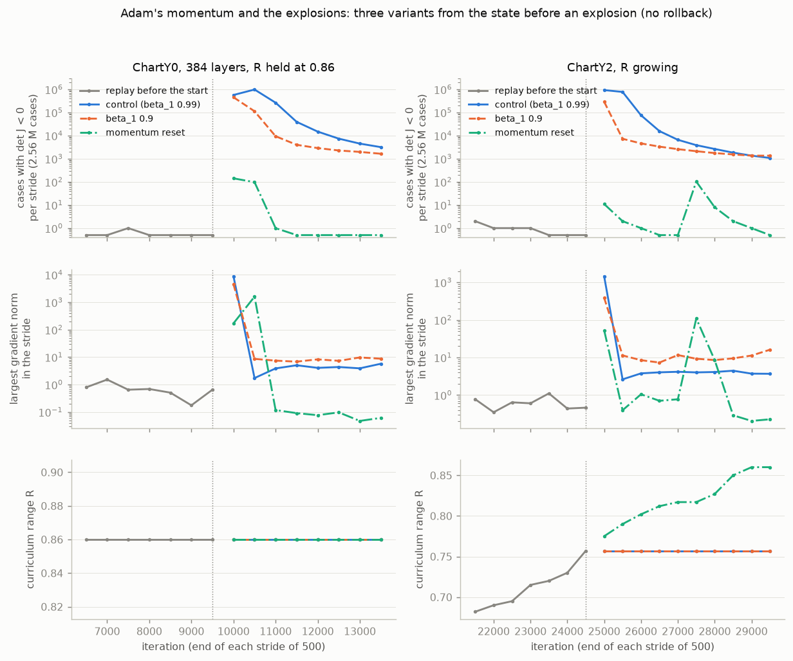

| Variant | ChartY0: most $`\det J < 0`$ in one stride | ChartY0: views solved at iteration 12,500 | ChartY2: most $`\det J < 0`$ in one stride | ChartY2: $`R`$ after 5000 iterations |
|---|---|---|---|---|
| control ($`\beta_1 = 0.99`$) | 982,557 | 13 % | 928,906 | 0.757 (stalled) |
| $`\beta_1 = 0.9`$ | 455,177 | 16 % | 290,449 | 0.757 (stalled) |
| momentum reset | 142 | 100 % | 103 | **0.86** |

*Strides of 500 iterations × 5120 cases. Views solved: exact check on 256 views, $`\max_k |\Delta p_k| < 0.01`$.*

- **The momentum reset prevents both explosions.** The gradient spikes still occur (on ChartY0 gradient norms up to 1600 and $`|\partial r/\partial p_k|`$ up to 45), but each is caught at once. The reset fired 6 times on ChartY0 and 5 times on ChartY2. ChartY2 continued its curriculum through the region where it had exploded and reached $`R = 0.86`$ after 4500 iterations, without rollback. Both end as functional twinchers: on $`|p|_\infty \le 0.86`$, no $`\det J \le 0`$, and of 1024 views 100 % are solved to < 0.01 and 98.5–98.7 % to < $`10^{-3}`$.
- **$`\beta_1 = 0.9`$ does not prevent them.** The explosions are smaller, but the twinchers are as broken as the controls (81–87 % of the views unsolved). On ChartY0, both variants explode about 250 iterations after the start (+248 and +265). By then any momentum accumulated before the start has decayed ($`0.99^{250} \approx 0.08`$), so a long accumulation over the quiet phase is not required. On ChartY2, $`\beta_1 = 0.9`$ broke the map within 3 iterations: at the same learning rate, a lower $`\beta_1`$ makes each step follow the noisy current gradient more closely.
- **Which momentum matters: the one a spike creates.** Suppose a gradient component suddenly becomes much larger than usual. Adam's first moment then carries the spike for $`\sim 1/(1-\beta_1)`$ steps, while its second moment keeps the normalization for $`\sim 1/(1-\beta_2)`$ steps. The total displacement of the parameter is therefore

  ```math
  \Delta\theta \approx \eta\, \frac{1 - \beta_1}{\sqrt{1 - \beta_2}} \sum_{k \ge 0} \left(\frac{\beta_1}{\sqrt{\beta_2}}\right)^k \approx \frac{\eta}{\sqrt{1 - \beta_2}} \approx 32\, \eta
  ```

  for $`\beta_1 = 0.99`$ and $`0.9`$ alike ($`\eta`$: learning rate, $`\beta_2 = 0.999`$; a direct simulation gives 33 and 32 learning rates). $`\beta_1`$ only sets how fast this happens: the first step is 0.3 learning rates with 0.99 and 3 with 0.9. A spike of the batch gradient thus becomes a coherent displacement of every affected parameter by tens of learning rates: an explosion. The reset removes most of it. The step just taken is reverted and the remaining momentum discarded, while the second moment, inflated by the spike, damps the following steps of exactly these parameters.

The hypothesis is thus confirmed in its core: Adam's momentum carries the map beyond admissible determinants, and resetting it prevents the explosion. It is not confirmed in its proposed origin, momentum accumulated by $`\beta_1 = 0.99`$ over a long quiet phase. The reset combines three actions (revert the last update, zero the first moment, a temporary dip of the learning rate), and this study does not separate which of them are essential. Each case was run once, from one state.

**Potential improvements.**

1. **Momentum reset in the recipe** (`momentum_reset` in [`train_charts_fb.py`](train_charts_fb.py)), with rollback kept as a last resort. Rollbacks halve the learning rate for good and lose a stride each time, while the reset costs one iteration. A test would retrain a Y chart from scratch with it.
2. **Ablations**: revert only, zeroing the momentum only, the learning-rate dip only. Also a trigger at the first negative determinant instead of 0.1 % of a batch, or triggers on the precursors of Section 13.5 (a gradient spike, a rise of $`|\partial r/\partial p_k|`$ over the domain).
3. **Treating the cause in the optimizer**: bound the update of each parameter (update clipping, as in Adafactor), or clip each gradient component to a multiple of $`\sqrt{v}`$ before it enters the moments. A single spike could then no longer move a parameter by tens of learning rates.
4. **Long-term stability**: the reset variants held for 4000–5000 iterations, where the controls collapsed after 250. Longer holds at $`R = 0.86`$ would show whether events remain rare.

The same arithmetic explains the restart shock of Section 13.3. With a fresh optimizer, $`v`$ is small for every parameter, so every gradient acts like a spike. Priming the moments remains necessary.

**A revision after the study.** In the first long run that used the reset (the noise post-training of Part III), its first version froze the training. After a spike, the twincher sat in a state with about 6 negative determinants per batch, just above the trigger level. The reset then fired in every iteration and halved the learning rate each time, faster than it could recover, so the learning rate fell to zero. In addition, after a reset the state "before the last update" was the rejected state, so consecutive resets alternated between two states. The revised reset (now the option `momentum_reset` of the package's hs loss, class `MomentumReset`) has three changes:

- it triggers only on a deterioration: more negative determinants than both 0.1 % of the batch and three times their running mean;
- it returns to the last accepted state, and one accepted state further back for each consecutive rejection;
- its learning-rate factor never drops below 0.05.

It handled every spike of the post-training runs (5 to 16 resets per run). The study above used the first version.

In the package, the reset is off by default. It is meant for the late stages of a training, when the map should stay clean. On a small problem trained from scratch (the spiral of the package's tests, batches of 256 cases), it fired on the isolated negative determinants that appear at the border of the growing box, and slowed the curriculum down or stopped it.

## 19. Next steps

The next milestone composes the six twinchers into one pose estimator for the connector. For each instance, the LidarFit pipeline of Part I (virtual camera, fused-target solver for unknown pixels, stencil centre) runs with every chart, and the solution that best matches the observation is kept. This is followed by an evaluation of the performance on the ITODD images and a comparison with alternative methods. Before that, the twinchers may need the robustness training of Section 4.2, adapted to the Fourier–Bessel stencil.

## 20. Reproducing milestone 2

Requirements as in Section 8, plus `mpmath` (Bessel functions). Run from this directory. The `output_*` directories hold checkpoints, histories (`history.csv`, `history_exact.csv`), results and the twinchers (`best.twc`). All training scripts can be interrupted and started again, and they continue from their last checkpoint. The WSL GPU driver occasionally killed a process (CUDA error 999), so long series ran in a loop that restarts them: `until python -u SCRIPT ...; do sleep 60; done`.

```bash
# Section 11: reduced ChartY0 (n_p = 2): wrinkles, vortices, capacity
python -u y0_reduced.py --runs s25_g8 s25_g12 s25_g16 c40 c40_l256 z0_c40
python grid_tangent.py --dims 1 2 --grids 16x48 32x96            # grid resolution without training
python wrinkle_map.py output_y0_reduced/s25_g8/best.twc --grid 8 8 --scale 0.25
python wrinkle_map.py output_y0_reduced/c40/final.twc --grid 32 96 --box 0.72
python -u y0_expand.py --runs d123 d123_l512                      # 3D with the flat stencil: folds at R 0.52
# Section 12: the Fourier-Bessel stencil
python stencil_metrics.py --chart Y0
python -u y0_fb.py --runs fb_bg20_l64 fb_bg20_d123                # collapses
# Section 13: whole-domain trimmer, 4D, more layers, roll-aware data
python -u y0_fb.py --runs fbtrim_bg20_l64 fbtrim_bg20_d123 fbtrim_full
cp output_y0_fb/fbtrim_full/best.twc output_y0_fb/best25000.twc   # the best state, iteration 25000
python twc_extend.py output_y0_fb/best25000.twc output_y0_fb/best25000_l384.twc --every 2
python -u y0_full.py --runs l384                                  # ChartY0: output_y0_full/l384/best.twc
python roll_fb_check.py --n 1024
# Section 14: the other five charts with the recipe (about 9 hours in total)
python -u train_charts_fb.py --runs Z0 Z1 Z2 Y1 Y2
python train_charts_fb.py --summary
# Section 16: training cost against the number of parameters
python figures_paper.py scaling --out-dir figures --format png  # figures/itodd_scaling.png
python twinch_widths.py output_y0_fb/fbtrim_bg20_l64/best.twc output_y0_fb/fbtrim_bg20_d123/best.twc \
    output_y0_full/l384/best.twc output_charts_fb/*/best.twc \
    output_train_noise_tent/final.twc output_train_noise_roll90_tent/final.twc
# Section 18: Adam's momentum
python -u adam_momentum.py replay_l384 replay_y2
python -u adam_momentum.py l384_ctrl l384_b09 l384_reset y2_ctrl y2_b09 y2_reset
python adam_momentum.py --summary
# figures of Part II
python figures_m2.py
```

At most two GPU jobs should run at a time on an 8 GB GPU: with three, the driver paged GPU memory and all of them stalled.

## 21. Files of milestone 2

| File | Purpose |
|---|---|
| [`train_chart.py`](train_chart.py) | Charts of four parameters (ChartZ, ChartY, roll centres), stencil factory, `ReducedStencil` for charts with fewer components |
| [`depth_stencil.py`](depth_stencil.py) | The forward model, now also with flat kernels, the Fourier–Bessel stencil (`FourierBessel`, option `fb`) and the conversion of poses into chart parameters |
| [`chart_training.py`](chart_training.py) | Resumable training of a chart: data (grid, pool, roll-aware), loss terms, initialization from a twincher with Adam priming and warmup, exact checks with winding numbers, best checkpoint, rollback, traces of explosions, stop criteria, momentum reset |
| [`roll_fb.py`](roll_fb.py), [`roll_fb_check.py`](roll_fb_check.py) | Roll-aware interpolation of Fourier–Bessel data and its check against rendering |
| [`winding.py`](winding.py) | Winding numbers of $`r`$ around small circles in $`p`$, any number of parameters |
| [`twc_extend.py`](twc_extend.py) | Insertion of zero-twist layers into a trained twincher |
| [`twinch_widths.py`](twinch_widths.py) | Widths and twists of the twinches of trained twinchers, against their initialization (Section 16.4) |
| [`wrinkle_map.py`](wrinkle_map.py), [`slice_dets.py`](slice_dets.py) | Maps of 2D and 3D twinchers: $`r`$ mesh, exact and interpolated $`\det J`$, tangent errors, solver errors, winding numbers |
| [`grid_tangent.py`](grid_tangent.py), [`interp_check.py`](interp_check.py) | Interpolation errors of training grids |
| [`stencil_metrics.py`](stencil_metrics.py) | Properties of $`y(p)`$ for stencil variants, before training |
| [`study_fd_step_chart.py`](study_fd_step_chart.py) | Finite-difference step for the charts of the connector |
| [`solver_failures.py`](solver_failures.py), [`eval_chart.py`](eval_chart.py) | Analysis of solver failures; evaluation of a chart twincher with exact data |
| [`y0_reduced.py`](y0_reduced.py), [`y0_expand.py`](y0_expand.py), [`y0_vortex.py`](y0_vortex.py), [`y0_fb.py`](y0_fb.py), [`y0_full.py`](y0_full.py) | The ChartY0 experiments of Sections 11–13, in this order (each with the reasons in its docstring) |
| [`train_charts_fb.py`](train_charts_fb.py) | The recipe and the resumable series of the six charts |
| [`adam_momentum.py`](adam_momentum.py) | The study of Section 18 |
| [`stencil_sweep.py`](stencil_sweep.py) | Stencil variants for ChartZ0 and ChartY0, and the promotion tolerance (Section 15) |
| [`figures_m2.py`](figures_m2.py) | Figures of Part II |
| [`hs_sep_loss.py`](hs_sep_loss.py) | Separation loss (did not help) |
| [`multires_interpolator.py`](multires_interpolator.py) | Multilinear interpolation with one resolution per component |

# Part III. Metrics and results

This part evaluates the approach on both objects of the previous parts, the cylinder (object 12, Part I) and the tee connector (object 26, Part II). Both are evaluated on all their instances in the real depth images of ITODD, with one configuration per object, in two versions: with and without the amodal mask of BOP. Section 22 states what the results are meant to show. Sections 23–24 describe the pipeline and the data. Section 25 defines the metrics, and Sections 26–27 present the results.

## 22. Positioning

This is the first application of twinchers to a public benchmark. The results are meant to show what the twincher primitive can do, and where the limits of the present architecture lie. They are not a bid to win the benchmark. The configuration is deliberately simple: one twincher per chart of view directions, Gauss–Newton iteration from a fixed start, and the solution with the smallest misfit among the charts. Any additional matching or search machinery would make it hard to tell what drives the success.

The twincher approach, as presented in the [preprint](https://arxiv.org/abs/2605.13470), relies on relatively complete data. Under that condition it provides:

1. global convergence, here from the fixed start $`p = 0`$ of each chart;
2. fast convergence, by Gauss–Newton iteration in a learned representation;
3. an error limited by the sensor, not by the learned model, since the solver uses the exact forward model;
4. a bridge across the sim-to-real gap: the twinchers are trained only on renderings of the CAD model;
5. no need for high-resolution images or visual features of the kind feature-matching methods rely on. A 512 × 512 depth rendering, condensed into 64–256 numbers, suffices.

The procedures of Parts I and III extend this to data with gaps: occlusions, shadows of the sensor, glossy surfaces and image borders. That broadens the range of applications beyond the straightforward use. Even with such gaps, the accuracy in many cases is far better than the correctness thresholds of BOP for ITODD. With good visibility, it appears to be limited by the deviations between the CAD model and the real object and by the sensor itself (Section 26).

Compensating systematically for missing data is a line of research of its own. Two directions look promising:

- **Local kernels.** The probes of the cylinder (Part I) are local kernels. They anchor the solution to the available data while the fused target fills the gaps. The Fourier–Bessel components of the connector (Part II) are global, so a gap changes every component. Twinchers for objects without symmetries could also be trained with stencils of localized kernels, which should be more robust to incomplete data.
- **Hybrid pipelines.** When the data are insufficient, an auxiliary method (e.g. a detector or a coarse pose estimator) can place an initial estimate within the convergence basin of the twincher, which then refines it. Finding the initial estimate need not be the twincher's task.

Two versions of the pipeline are evaluated. The first uses the amodal mask of BOP (`mask`, the full silhouette including occluded parts), which is derived from the ground truth. It stands for a deployment together with an advanced detection module that provides such masks. The second uses only the depth map and the mask of the visible part (`mask_visib`), as a segmentation would provide it.

## 23. Pipeline and configurations

### 23.1 LidarFit with several charts

[`lidar_fit.py`](lidar_fit.py) (Section 6) now handles the four-parameter charts of Part II. Each chart takes its stencil from the metadata of its twincher. All charts are solved, each from $`p = 0`$ with two variants of the fused solver step (Newton and plain), and the solution with the smallest misfit to the observation is kept. The connector thus runs 12 solutions per instance, 20 Gauss–Newton steps each; the cylinder runs 4. Three additions of this milestone apply to both objects:

- **Clamp.** $`p`$ is kept in the box on which the twinchers are embeddings: $`|p_k| \le 0.86`$ for the connector, $`\le 1`$ for the cylinder.
- **Visible silhouette** (`fill_visib`, `fill_target`). On the test images, most unavailable pixels of an object are holes in the sensor depth inside `mask_visib` (Section 24). Before, they were unknown and took the depth of the rendering. Where the rendering missed them, they became background, so a solution could slide off the visible object at no cost. Now they count as object and as known. They take the rendered depth, or the depth of the nearest observed pixels where the rendering misses them. This enters both the target of the solver and the misfit.
- **Without the amodal mask** (observation `visib`). Outside `mask_visib`, a pixel where the rendered object lies in front of the observed surface by more than 5 mm is free space, because the object would otherwise be visible there. Elsewhere outside `mask_visib` (an occluder in front, or no depth), the pixel takes the rendering.

### 23.2 Noise post-training of the connector twinchers

The six chart twinchers of Part II were trained further for robustness to perturbations, as the cylinder's in Section 4.2 ([`noise_charts.py`](noise_charts.py)). The single-mode noise term `hs_sm_noise` of the package (amplitude $`10^{-3}`$, cases up to 0.05 off the manifold) made $`r`$ insensitive to changes of $`y`$ perpendicular to the data manifold. The determinant and trimmer terms acted as guard rails, with $`R`$ held at 0.86. Each run started with 1000 iterations that only prime Adam's moments, then warmed up the learning rate over 2000 iterations (Section 13.3), and used the revised momentum reset (end of Section 18). ChartZ0 ran 30,000 iterations, the others 20,000; no run had an explosion. The test of [`noise_check_chart.py`](noise_check_chart.py) adds noise perpendicular to the manifold, of norm up to 0.5, to rendered views and solves them. $`\eta`$ is the median of $`|\Delta p| / |\text{noise}|`$:

| Chart | $`\eta`$ before | $`\eta`$ after | solved at noise < 0.1, before → after | noise-free median error, before → after |
|---|---|---|---|---|
| Z0 | 0.73 | 0.25 | 25 → 68 % | $`4.4 \to 1.9 \times 10^{-5}`$ |
| Z1 | 0.92 | 0.30 | 20 → 46 % | $`5.5 \to 1.8 \times 10^{-5}`$ |
| Z2 | 0.86 | 0.28 | 20 → 50 % | $`5.3 \to 2.1 \times 10^{-5}`$ |
| Y0 | 0.86 | 0.54 | 21 → 30 % | $`9.9 \to 6.4 \times 10^{-5}`$ |
| Y1 | 0.92 | 0.49 | 24 → 34 % | $`13 \to 6.7 \times 10^{-5}`$ |
| Y2 | 1.00 | 0.55 | 24 → 37 % | $`12 \to 7.9 \times 10^{-5}`$ |

The sensitivity to off-manifold perturbations fell by a factor of 1.6–3.1 (2.9–3.1 for the Z charts, 1.6–1.9 for the Y charts), and the median noise-free error fell by a factor of 1.5–3.1. For ChartZ0, the snapshots show most of the gain within 20,000 iterations: $`\eta`$ was 0.31 at 10,000, 0.25 at 20,000 and 0.25 at 30,000. The Y charts, whose views look into the bores, gain less.

### 23.3 Configurations

| Object | With the amodal mask | Without it |
|---|---|---|
| cylinder | [`lidarfit_obj12_m3_tent_mask.json`](lidarfit_obj12_m3_tent_mask.json) | [`lidarfit_obj12_m3_tent_visib.json`](lidarfit_obj12_m3_tent_visib.json) |
| tee connector | [`lidarfit_obj26_m3_mask.json`](lidarfit_obj26_m3_mask.json) | [`lidarfit_obj26_m3_visib.json`](lidarfit_obj26_m3_visib.json) |

The cylinder uses its twinchers with the tent-weighted probe kernel. They did better than those of the pyramid ("max") kernel of milestone 1 in both versions: 68 vs 67 of 70 test instances with silhouette IoU ≥ 0.95 with the mask, 65 vs 61 without it (`output_m3/obj12_max_*`). The connector uses the six post-trained twinchers.

How the additions of this milestone changed the connector's results: 148 test instances (images 644–673), counting solutions with silhouette IoU ≥ 0.95, and the synthetic test [`test_lidarfit_synth.py`](test_lidarfit_synth.py):

| Connector, with the mask | test: IoU ≥ 0.95 | synthetic: occluded (20–40 %) | synthetic: image border cuts 10–40 % of the mask |
|---|---|---|---|
| twinchers of Part II | 82 of 148 | 87 % | 53 % |
| + visible silhouette, clamp | 105 | 90 % | 57 % |
| + noise post-training | **114** | **97 %** | **77 %** |

(Synthetic: 30 rendered instances per variant; the solution counts as correct if its MSSD is below 5 % of the diameter. The synthetic data have no sensor holes, so the visible silhouette changes nothing there; that row is the clamp alone. Without occlusion or cuts, 100 % were solved, with a median MSSD of 0.03 mm.)

One instance takes 3.4 s for the cylinder and 8.8 s for the connector (medians, laptop GPU NVIDIA GeForce RTX 5050).

## 24. Instances and the availability of data

All instances of the two objects in the validation and test images of ITODD (BOP scene 000001) are used; [`run_m3.py`](run_m3.py) lists them:

| Object | Validation (ground truth) | Test (ground truth withheld by BOP) |
|---|---|---|
| cylinder | images 230, 233: 4 instances | 13 images (231–244), 70 instances |
| tee connector | images 643, 658: 6 instances | 644–657 and 673 (connectors only): 101 instances; 659–672, 735, 736, 743–745 (among other objects): 58 instances |

How much of an instance can be seen is measured in the camera image, from the masks of BOP and the depth map, independently of the method ([`pose_metrics.py`](pose_metrics.py)). Relative to the amodal mask $`M`$ (`mask`):

```math
f_\text{holes} = \frac{|V \setminus D|}{|M|}, \qquad f_\text{occluded} = \frac{|M \setminus V|}{|M|}, \qquad f_\text{unavailable} = f_\text{holes} + f_\text{occluded} = 1 - \frac{|V \cap D|}{|M|},
```

where $`V`$ is `mask_visib` and $`D`$ the set of pixels with depth. Parts outside the image are not in the masks of BOP and are not counted.

For both objects, the unavailable pixels are mostly holes. The median unavailable fraction is 28 % for the cylinder and 30 % for the connector. Of this, holes make up 25 % and 24 %, occluded pixels only 0.2 % and 1 %. More than 10 % of the mask is occluded for 9 of 74 cylinders and 47 of 165 connectors. The holes come from shadows of the structured-light sensor, which lie beside every object on the same side, and from glossy or dark surfaces, such as the metal rings and bores of the connector.

## 25. Metrics

**Agreement with the observation** (no ground truth needed), for the depth map $`Z_\text{sol}`$ of the solution rendered with the real camera:

- **Depth mismatch**: the mean of $`|Z_\text{sol} - Z_\text{sensor}|`$ over the pixels where both show the object, i.e. pixels of `mask_visib` with depth that the solution covers.
- **Silhouette mismatch**: $`1 - \text{IoU}`$ of the silhouette of the solution and the amodal mask. In the version without the mask, the mask is used only here.
- **Depth scatter** (called "scatter" in Parts I–II and in the per-instance figures): $`\Delta Z = Z_\text{sol} - Z_\text{sensor}`$ on the interior pixels of the object (the pixels above, eroded by 3 pixels, so that pixels mixing object and background are left out). A plane $`\Delta Z = a + b u + c v`$ is fitted by least squares and refitted twice without the residuals beyond 3 standard deviations. The scatter is the robust standard deviation of the residuals, $`1.4826 \times`$ their median absolute deviation. The fit separates a pose error, which appears as an offset ($`a`$) or a tilt ($`b, c`$), from the roughness that no pose can remove: sensor noise and deviations of the real object from its CAD model.

A solution **agrees with the observation** if its silhouette IoU is at least 0.95 and its depth mismatch at most 2 mm. On the validation images, all solutions agree and all are correct by every criterion of BOP (table in Section 26.3).

**Pose errors of BOP** (ground truth needed), as defined for the BOP challenge (Hodan et al.) and implemented in [`pose_metrics.py`](pose_metrics.py) after the BOP toolkit (not validated against it). $`D`$ is the object diameter (107.7 mm for the cylinder, 66.8 mm for the connector).

- **VSD** (visible surface discrepancy): the fraction of the visible surface where the depth of the estimate deviates from that of the ground truth by more than $`\tau`$; $`\delta`$ = 15 mm for the visibility, $`\tau = 0.05 \ldots 0.5\,D`$.
- **MSSD** (maximum symmetry-aware surface distance): the largest distance of a model vertex between the estimated and the true pose, minimized over the symmetries of the object.
- **MSPD** (maximum symmetry-aware projection distance): the same for the projections into the image, in pixels.

A pose is correct if its error is below a threshold: VSD 0.05–0.5, MSSD 0.05–0.5 $`D`$, MSPD 5–50 $`r`$ pixels, with $`r`$ = image width / 640 = 2. Per instance, the score of each metric is the fraction of thresholds (and values of $`\tau`$) at which the pose is correct. The mean score over instances is the average recall $`\text{AR}_\text{VSD}`$, $`\text{AR}_\text{MSSD}`$ or $`\text{AR}_\text{MSPD}`$ of BOP, and $`\text{AR}`$ is their mean.

## 26. Results

Code: [`run_m3.py`](run_m3.py) (solutions and metrics), [`figures_m3.py`](figures_m3.py) (figures and tables).

### 26.1 Agreement with the observation against the unavailable fraction

Instances cut by the image border are left out here and in Section 26.2: 12 cylinders and 9 connectors. Their parts outside the image are not in the masks of BOP, so their unavailable fraction would be underestimated. They are counted separately below.

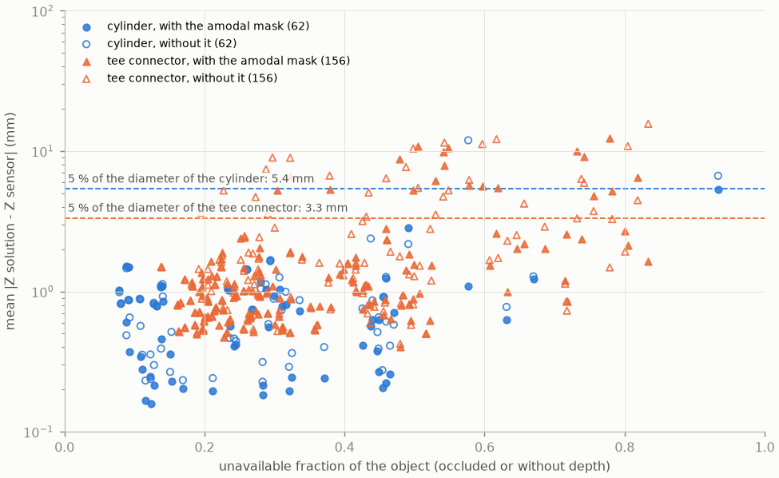

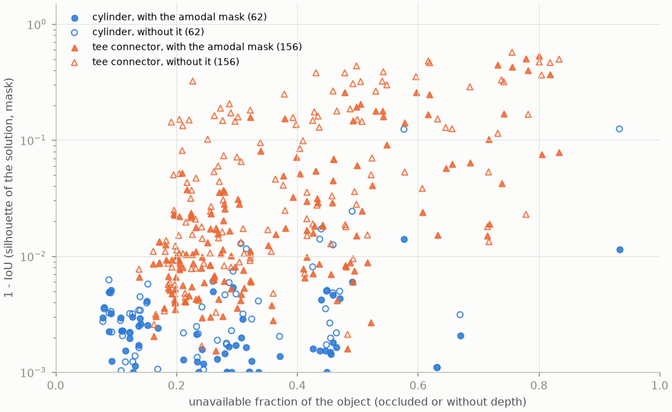

*One marker per instance (validation and test, not cut by the image border). Circles: cylinder; triangles: connector; filled: with the amodal mask; open: without it. Dashed lines in the upper figure: 5 % of the object diameter (5.4 mm for the cylinder, 3.3 mm for the connector), the strictest MSSD threshold of BOP, as a scale for the depth mismatch. Silhouette mismatches below $`10^{-3}`$ are drawn at $`10^{-3}`$.*

Solutions that agree with the observation, by unavailable fraction:

| Object, version | 0–30 % | 30–45 % | 45–60 % | 60–75 % | 75–100 % | all |
|---|---|---|---|---|---|---|
| cylinder, with the mask | 38 of 38 | 13 of 13 | 7 of 8 | 2 of 2 | 0 of 1 | 60 of 62 (97 %) |
| cylinder, without it | 38 of 38 | 12 of 13 | 6 of 8 | 2 of 2 | 0 of 1 | 58 of 62 (94 %) |
| connector, with the mask | 70 of 74 | 28 of 35 | 14 of 27 | 4 of 13 | 0 of 7 | 116 of 156 (74 %) |
| connector, without it | 55 of 74 | 20 of 35 | 9 of 27 | 3 of 13 | 1 of 7 | 88 of 156 (56 %) |

Instances cut by the image border (part of the object outside the image), solutions that agree with the observation:

| Object | with the mask | without it |
|---|---|---|
| cylinder | 9 of 12 | 8 of 12 |
| connector | 7 of 9 | 7 of 9 |

- With up to 30 % of the object unavailable, nearly all solutions agree with the observation: all 38 cylinders and 95 % of the connectors with the mask. Beyond 45 % the success rate falls, and beyond 75 % almost nothing is solved. This is the dependence on relatively complete data stated in Section 22.
- **Precision of the agreeing solutions** (all instances, also those at the border). Median depth mismatch 0.63 mm (cylinder) and 0.85 mm (connector); silhouette mismatch 0.2 % and 0.9 %. Their depth differs from the sensor by an offset of 0.09 and 0.18 mm (median of the absolute plane offset), with a scatter of 0.19 and 0.49 mm around the plane. The sensor noise on a flat table is 0.08 mm (Section 1). The remaining scatter, larger for the connector with its rings and threads, comes from deviations between the real objects and the CAD models and from systematic errors of the sensor, which no pose can remove.
- **Without the amodal mask**, the cylinder loses little (94 vs 97 %). The connector loses more (56 vs 74 %), even with little missing data (55 vs 70 of 74 below 30 %). The amodal mask fixes the whole silhouette, including the parts behind other objects. It also marks background where the free-space carving cannot, namely where no depth was measured behind the object. Its silhouette is far more distinctive than that of the cylinder.

### 26.2 Over a threshold of the unavailable fraction

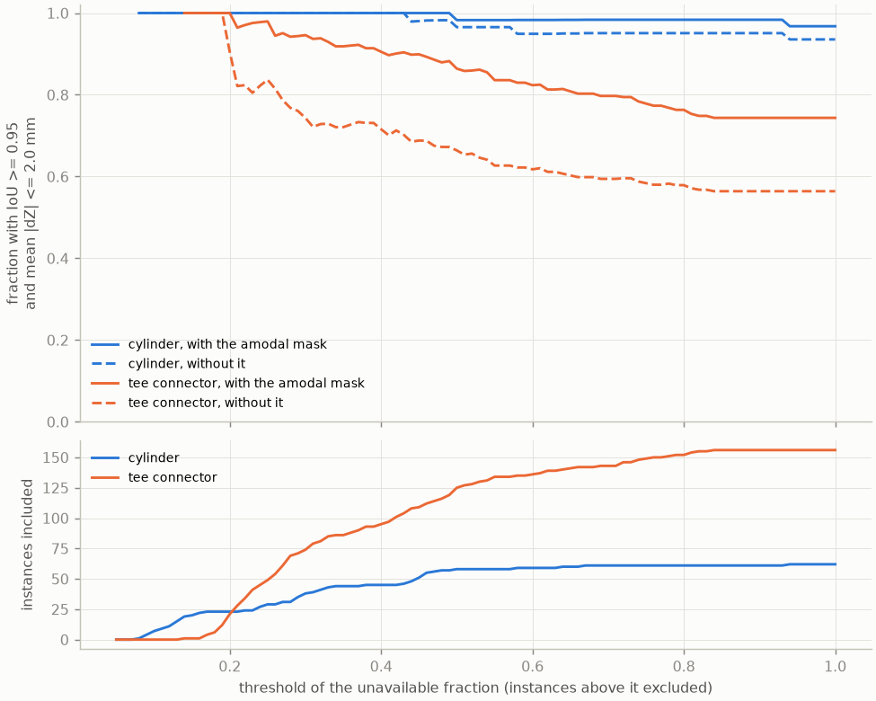

*Instances whose unavailable fraction exceeds the threshold are excluded. The right end of each curve covers all instances not cut by the image border. Lower panel: the number of instances included.*

### 26.3 Pose errors by the criteria of ITODD

The ground truth of the test images is not public (BOP evaluates test results by submission), so the pose errors of BOP can only be computed for the validation instances:

| Object | Version | Instance | Unavailable | MSSD (mm) | MSPD (px) | $`e_\text{VSD}`$ ($`\tau`$ 0.05–0.5 $`D`$) | AR |
|---|---|---|---|---|---|---|---|
| cylinder | mask | 230/0 | 15 % | 0.27 | 0.65 | 0.004 | 1 |
| cylinder | mask | 233/0 | 12 % | 0.96 | 1.59 | 0.009–0.010 | 1 |
| cylinder | mask | 233/1 | 15 % | 1.48 | 2.30 | 0.006 | 1 |
| cylinder | mask | 233/2 | 12 % | 1.37 | 1.32 | 0.007 | 1 |
| cylinder | visib | 230/0 | 15 % | 0.40 | 0.68 | 0.005 | 1 |
| cylinder | visib | 233/0 | 12 % | 0.79 | 1.52 | 0.010 | 1 |
| cylinder | visib | 233/1 | 15 % | 0.97 | 2.34 | 0.008 | 1 |
| cylinder | visib | 233/2 | 12 % | 1.20 | 1.33 | 0.007 | 1 |
| connector | mask | 643/0 | 22 % | 0.41 | 1.10 | 0.011–0.013 | 1 |
| connector | mask | 643/1 | 16 % | 0.46 | 1.35 | 0.014–0.016 | 1 |
| connector | mask | 643/2 | 20 % | 0.91 | 2.16 | 0.014–0.018 | 1 |
| connector | mask | 643/3 | 24 % | 0.67 | 2.02 | 0.015–0.028 | 1 |
| connector | mask | 643/4 | 19 % | 0.58 | 1.12 | 0.014–0.017 | 1 |
| connector | mask | 658/0 | 19 % | 0.62 | 2.15 | 0.010–0.019 | 1 |
| connector | visib | 643/0 | 22 % | 0.51 | 1.41 | 0.014–0.016 | 1 |
| connector | visib | 643/1 | 16 % | 0.47 | 1.35 | 0.014–0.016 | 1 |
| connector | visib | 643/2 | 20 % | 0.90 | 2.14 | 0.018–0.024 | 1 |
| connector | visib | 643/3 | 24 % | 0.69 | 2.05 | 0.015–0.028 | 1 |
| connector | visib | 643/4 | 19 % | 0.59 | 1.23 | 0.016–0.020 | 1 |
| connector | visib | 658/0 | 19 % | 0.69 | 2.19 | 0.014–0.023 | 1 |

All validation instances are correct at every threshold of BOP (AR = 1). Their largest errors lie a factor of 1.8 (VSD) to 4.3 (MSPD) below the strictest thresholds, and the median MSSD (1.16 mm for the cylinder, 0.60 mm for the connector) lies a factor of 4.6 and 5.6 below them:

| Metric | Largest error here | Strictest BOP threshold |
|---|---|---|
| MSSD | 1.48 mm | 5.4 mm (cylinder), 3.3 mm (connector) |
| MSPD | 2.3 px | 10 px |
| $`e_\text{VSD}`$ | 0.028 | 0.05 |

On ITODD, the criteria of BOP therefore separate solutions found from solutions not found, but they cannot resolve the precision of these solutions. Ten instances are too few for curves over the unavailable fraction, so the pose errors are given as this table only.

## 27. Whole scenes

[`scene_demo.py`](scene_demo.py) shows the solutions of all instances of an image in one row: **[Source]** the measured depth with the masks, **[Solution]** the solved instances in front of a fitted background plane, **[Mismatch]** the signed depth difference, **[Reconstruction]** the solution shaded from above, **[Ground Truth]** the gray image of the scene. The background plane is fitted to random pixels with depth outside all masks (the median over 400 triples). Every image of both objects is rendered in both versions, with and without the amodal mask (`output_m3/scenes_mask/`, `output_m3/scenes_visib/`). The colour scales are fixed for all scenes:

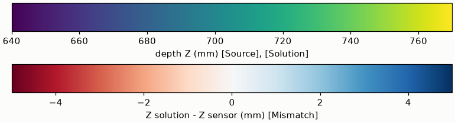

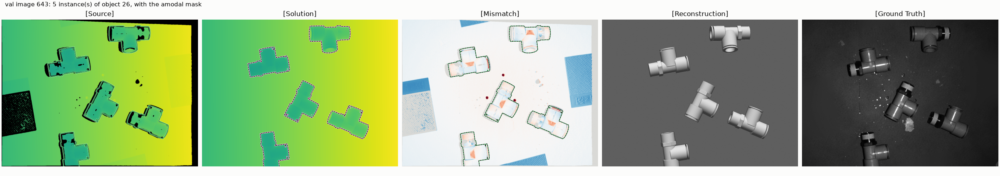

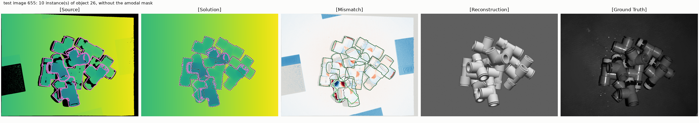

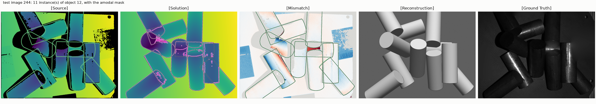

*Outlines: magenta `mask_visib`; green `mask` (in [Source] only with the mask); black, dashed, on top: the whole silhouette of each solution, including parts hidden by other instances (as in `mask`). All outlines have a thin white halo. In image 244, the silhouettes of all eleven solutions match their masks (IoU ≥ 0.986). This includes a cylinder lying under the others with 93 % of its surface unavailable; its depth mismatch of 5.4 mm, though, exceeds the 2 mm of the agreement criterion.*

## 28. Further indicative metrics

- **Agreement over a threshold of the unavailable fraction** (Section 26.2). This shows the operating range of the approach without ground truth.
- **Offset and scatter of the depth difference** for the agreeing solutions (Section 26.1). They separate errors of the pose from the deviations of the object and the sensor; their size relative to the sensor noise shows how close the solutions come to the limit of the data.
- **Time per instance**, and the number of Gauss–Newton steps to convergence. The latter is not evaluated yet; 20 steps per solution are run.
- **Pose errors over the unavailable fraction**, given more instances with ground truth.

## 29. Reproducing Part III

Requirements as in Sections 8 and 20; the twinchers of Parts I and II. Run from this directory:

```bash
# the cylinder twinchers with the tent kernel (Section 23.3), as those of Section 8
python -u train_cylinder.py output_train_cylinder_tent --kernel tent
python -u train_noise.py output_train_noise_tent --init output_train_cylinder_tent/final.twc \
    --data output_train_cylinder_tent/data_n32_res512_dp0.05_centre_tent.pt
python -u train_cylinder.py output_train_cylinder_roll90_tent --kernel tent --roll-range 0.3 2.8415926535897933
python -u train_noise.py output_train_noise_roll90_tent --init output_train_cylinder_roll90_tent/final.twc \
    --data output_train_cylinder_roll90_tent/data_n32_res512_dp0.05_centre_roll0.300_2.842_tent.pt
# noise post-training of the six connector charts (~2-3 h each), and the noise check
python -u noise_charts.py --runs z0                    # then z0_reset2 (continues it), z1 z2 y0 y1 y2
python noise_check_chart.py output_charts_fb/Z1/best.twc output_noise_charts/z1/final.twc
# synthetic tests of LidarFit with six charts
python -u test_lidarfit_synth.py --config lidarfit_obj26_m3_mask.json --n 30
# all instances with metrics (cylinder ~5 min, connector ~25 min per version)
python -u run_m3.py --object 12 --config lidarfit_obj12_m3_tent_mask.json --out-dir output_m3/obj12_tent_mask
python -u run_m3.py --object 12 --config lidarfit_obj12_m3_tent_visib.json --out-dir output_m3/obj12_tent_visib
python -u run_m3.py --object 26 --config lidarfit_obj26_m3_mask.json --out-dir output_m3/obj26_mask
python -u run_m3.py --object 26 --config lidarfit_obj26_m3_visib.json --out-dir output_m3/obj26_visib
python figures_m3.py
python scene_demo.py --mode mask                       # and --mode visib
# the comparisons of Section 23.3: the max kernel for the cylinder, the additions for the connector
python -u run_m3.py --object 12 --config lidarfit_obj12_m3_max_mask.json --out-dir output_m3/obj12_max_mask   # and _visib
python -u run_lidarfit_obj26.py --config lidarfit_obj26.json --out-dir output_lidarfit_obj26   # and _fill, _fill_pt
python -u test_lidarfit_synth.py --config lidarfit_obj26.json --n 30 --out-dir output_lidarfit_synth   # and _clamp, _fill_pt
```

## 30. Files of Part III

| File | Purpose |
|---|---|
| [`lidar_fit.py`](lidar_fit.py) | LidarFit: charts with the stencil of their twinchers, clamp, visible silhouette (`fill_visib` for both observations), `load_instance` / `process` |
| [`pose_metrics.py`](pose_metrics.py) | Availability, agreement with the observation, pose errors of BOP (VSD, MSSD, MSPD, AR) |
| [`run_m3.py`](run_m3.py) | All instances of an object with the metrics |
| [`figures_m3.py`](figures_m3.py) | Figures and tables of Part III |
| [`scene_demo.py`](scene_demo.py) | Whole-scene demonstration |
| [`noise_charts.py`](noise_charts.py), [`noise_check_chart.py`](noise_check_chart.py) | Noise post-training of the chart twinchers and its test |
| [`test_lidarfit_synth.py`](test_lidarfit_synth.py) | LidarFit on synthetic instances (centred, anywhere, occluded, cut by the border) |
| [`chart_training.py`](chart_training.py) | Also: snapshots, the noise sensitivity in the history, the momentum reset of the hs loss (and its first version, `FirstReset`) |
| [`run_lidarfit_obj26.py`](run_lidarfit_obj26.py) | LidarFit on the connector instances of images 643–673 (the comparison in Section 23.3) |
| `lidarfit_obj26.json`, `lidarfit_obj26_clamp.json`, `lidarfit_obj26_fill.json`, `lidarfit_obj26_fill_pt.json` | The configurations of that comparison |
| `lidarfit_obj12_m3_*.json`, `lidarfit_obj26_m3_*.json` | The configurations of Section 23.3 (and the cylinder candidates with the max kernel) |

# Part IV. Analyses for the preprint

## 31. Analyses for the preprint

The section of the [preprint](https://arxiv.org/abs/2605.13470) on ITODD summarizes Parts I–III. This part documents the analyses that the preprint adds to them. The comparison of the training cost for two, three and four parameters, also made for the preprint, is in Section 16, next to the runs it uses.

### 31.1 Gauss–Newton in observation space

Code: [`data_space_gn.py`](data_space_gn.py) (results in `output_data_space_gn/results.json`).

How much do the learned coordinates contribute? For every chart of the configurations of Section 23.3, 256 random synthetic views of the trained box are rendered and solved with the same stencil, the same start and the same clamp of $`p`$ in two ways: Gauss–Newton in the representation $`r`$ of the twincher (30 steps), and damped Gauss–Newton in the space of $`y`$, $`(J^\top J + \lambda I)\,\Delta p = J^\top (y_\text{true} - y(p))`$ with $`\lambda = 10^{-3}`$ and the step clipped to $`|\Delta p| \le 0.1`$ (60 steps; the baseline of the harmonic entanglers in the preprint). Views solved to $`\max_k |\Delta p_k| < 0.01`$:

| Charts | in $`r`$, from $`p = 0`$ | in $`y`$, from $`p = 0`$ (without clipping) | in $`r`$, random start | in $`y`$, random start | $`C = -\ln p_\text{success}`$ in $`y`$ |
|---|---|---|---|---|---|
| cylinder A, B | 100 % | 70 % (99 %) | 100 % | 68 % | 0.39 |
| connector Z0–Z2 | 100 % | 72–73 % (68–69 %) | 100 % | 36–38 % | 0.98–1.01 |
| connector Y0–Y2 | 100 % | 50 % (51–52 %) | 99.6–100 % | 28–29 % | 1.24–1.25 |

In $`r`$, more than 99 % of the views are solved within five steps (99.5 % of all views to < 0.001 after 30 steps). The forward model and its Jacobians are the same in both cases; only the coordinates differ. Charts A and B of the cylinder give identical results in $`y`$: a roll by 90° permutes the square probe grid exactly.

### 31.2 Convergence on real data

Code: [`gn_trajectories.py`](gn_trajectories.py) (outputs in `output_gn_trajectories/`). It runs LidarFit with the configurations "with the amodal mask" of Section 23.3 and records the pose after each Gauss–Newton step of the solution that LidarFit selects. All re-runs reproduce the solutions of `run_m3.py` exactly.

- **Validation** (10 instances): from the centre of the chart, where the MSSD is 26–39 mm (cylinder) and 49–84 mm (connector), the MSSD reaches its final level within 3–5 steps; 643/0 (cut by the border, 62 % unavailable) needs 7. The residual of the solver in $`r`$ falls by three to four orders of magnitude and levels off at $`10^{-5}`$–$`10^{-3}`$.
- **All cylinder instances** (74; test ground truth withheld): the 69 solutions that agree with the observation come within 1 mm (MSSD) of their final pose after a median of 3 steps, and within 6 steps for 90 % of them. The connector test instances were not run.

### 31.3 Noise tolerance of the cylinder twinchers with the tent kernel

Section 4.2 measured the max-kernel twinchers of milestone 1. For the tent-kernel twinchers of Part III ([`noise_check_depth.py`](noise_check_depth.py), 1024 views, noise normal to the manifold of norm up to 1; outputs in `output_noise_check_tent/`), $`\eta`$ fell from 0.179 to 0.033 (chart A) and from 0.195 to 0.035 (chart B) with the robustness training, and the ratio residual / noise from 1.52 to 1.02.

### 31.4 Figures of the preprint

[`figures_paper.py`](figures_paper.py) writes the figures of the preprint as PDF (scenes, agreement, convergence, scaling, branch points, momentum) from the outputs above and of Parts II and III; the scenes and the branch points render views and need a GPU. With `--format png`, it writes the same figures as PNG, as for Section 16.

```bash
python -u data_space_gn.py --n 256 --n-iter-r 30 --n-iter-y 60            # ~23 min
python -u gn_trajectories.py --object 12 --config lidarfit_obj12_m3_tent_mask.json \
    --results output_m3/obj12_tent_mask/results.json --out output_gn_trajectories/obj12_mask.json
python -u gn_trajectories.py --object 26 --config lidarfit_obj26_m3_mask.json \
    --results output_m3/obj26_mask/results.json --out output_gn_trajectories/obj26_mask_val.json --split val
python noise_check_depth.py output_train_cylinder_tent/final.twc output_train_noise_tent/final.twc \
    --out-dir output_noise_check_tent/chart_A                               # and chart B (roll90)
python figures_paper.py                                                    # PDF in output_figures_paper/
```
